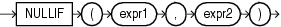

## NULLIF

Syntax



> ```
> NULLIF(expr1, expr2)
> ```
>
> [  
> Copyright © 1996, 2025, Oracle and/or its affiliates.](https://docs.oracle.com/en/database/oracle/oracle-database/dcommon/html/cpyr.htm)


Purpose

`NULLIF` compares `expr1` and `expr2`. If they are equal, then the function returns null. If they are not equal, then the function returns `expr1`. You cannot specify the literal `NULL` for `expr1`.

If both arguments are numeric data types, then Oracle Database determines the argument with the higher numeric precedence, implicitly converts the other argument to that data type, and returns that data type. If the arguments are not numeric, then they must be of the same data type, or Oracle returns an error.

The `NULLIF` function is logically equivalent to the following `CASE` expression:

```
CASE WHEN expr1 = expr2 THEN NULL ELSE expr1 END
```

See Also:

- " [CASE Expressions](CASE-Expressions.md) "
- Appendix C in [Oracle Database Globalization Support Guide](https://docs.oracle.com/pls/topic/lookup?ctx=en/database/oracle/oracle-database/21/sqlrf&id=NLSPG-GUID-AFCE41ED-775B-4A00-AF38-C436776AE0C5) for the collation determination rules, which define the collation `NULLIF` uses to compare characters from `expr1` with characters from `expr2`, and for the collation derivation rules, which define the collation assigned to the return value of this function when it is a character value

Examples

The following example selects those employees from the sample schema `hr` who have changed jobs since they were hired, as indicated by a `job_id` in the `job_history` table different from the current `job_id` in the `employees` table:

```
SELECT e.last_name, NULLIF(j.job_id, e.job_id) "Old Job ID"
  FROM employees e, job_history j
  WHERE e.employee_id = j.employee_id
  ORDER BY last_name, "Old Job ID";

LAST_NAME                 Old Job ID
------------------------- ----------
De Haan                   IT_PROG
Hartstein                 MK_REP
Kaufling                  ST_CLERK
Kochhar                   AC_ACCOUNT
Kochhar                   AC_MGR
Raphaely                  ST_CLERK
Taylor                    SA_MAN
Taylor
Whalen                    AC_ACCOUNT
Whalen
```