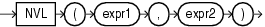

## NVL

Syntax



> ```
> NVL(expr1, expr2)
> ```
>
> [  
> Copyright © 1996, 2025, Oracle and/or its affiliates.](https://docs.oracle.com/en/database/oracle/oracle-database/dcommon/html/cpyr.htm)


Purpose

`NVL` lets you replace null (returned as a blank) with a string in the results of a query. If `expr1` is null, then `NVL` returns `expr2`. If `expr1` is not null, then `NVL` returns `expr1`.

The arguments `expr1` and `expr2` can have any data type. If their data types are different, then Oracle Database implicitly converts one to the other. If they cannot be converted implicitly, then the database returns an error. The implicit conversion is implemented as follows:

- If `expr1` is character data, then Oracle Database converts `expr2` to the data type of `expr1` before comparing them and returns `VARCHAR2` in the character set of `expr1`.
- If `expr1` is numeric, then Oracle Database determines which argument has the highest numeric precedence, implicitly converts the other argument to that data type, and returns that data type.

See Also:

- [Table 2-8](Data-Type-Comparison-Rules.md) for more information on implicit conversion and " [Numeric Precedence](Data-Types.md) " for information on numeric precedence
- " [COALESCE](COALESCE.md) " and " [CASE Expressions](CASE-Expressions.md) ", which provide functionality similar to that of `NVL`
- Appendix C in [Oracle Database Globalization Support Guide](https://docs.oracle.com/pls/topic/lookup?ctx=en/database/oracle/oracle-database/21/sqlrf&id=NLSPG-GUID-AFCE41ED-775B-4A00-AF38-C436776AE0C5) for the collation derivation rules, which define the collation assigned to the return value of `NVL` when it is a character value

Examples

The following example returns a list of employee names and commissions, substituting "Not Applicable" if the employee receives no commission:

```
SELECT last_name, NVL(TO_CHAR(commission_pct), 'Not Applicable') commission
  FROM employees
  WHERE last_name LIKE 'B%'
  ORDER BY last_name;
 
LAST_NAME                 COMMISSION
------------------------- ----------------------------------------
Baer                      Not Applicable
Baida                     Not Applicable
Banda                     .1
Bates                     .15
Bell                      Not Applicable
Bernstein                 .25
Bissot                    Not Applicable
Bloom                     .2
Bull                      Not Applicable
```