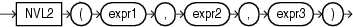

## NVL2

Syntax



> ```
> NVL2(expr1, expr2, expr3)
> ```
>
> [  
> Copyright © 1996, 2025, Oracle and/or its affiliates.](https://docs.oracle.com/en/database/oracle/oracle-database/dcommon/html/cpyr.htm)


Purpose

`NVL2` lets you determine the value returned by a query based on whether a specified expression is null or not null. If `expr1` is not null, then `NVL2` returns `expr2`. If `expr1` is null, then `NVL2` returns `expr3`.

The argument `expr1` can have any data type. The arguments `expr2` and `expr3` can have any data types except `LONG`.

If the data types of `expr2` and `expr3` are different, then Oracle Database implicitly converts one to the other. If they cannot be converted implicitly, then the database returns an error. If `expr2` is character or numeric data, then the implicit conversion is implemented as follows:

- If `expr2` is character data, then Oracle Database converts `expr3` to the data type of `expr2` before returning a value unless `expr3` is a null constant. In that case, a data type conversion is not necessary, and the database returns `VARCHAR2` in the character set of `expr2`.
- If `expr2` is numeric data, then Oracle Database determines which argument has the highest numeric precedence, implicitly converts the other argument to that data type, and returns that data type.

See Also:

- [Table 2-8](Data-Type-Comparison-Rules.md) for more information on implicit conversion and " [Numeric Precedence](Data-Types.md) " for information on numeric precedence
- Appendix C in [Oracle Database Globalization Support Guide](https://docs.oracle.com/pls/topic/lookup?ctx=en/database/oracle/oracle-database/21/sqlrf&id=NLSPG-GUID-AFCE41ED-775B-4A00-AF38-C436776AE0C5) for the collation derivation rules, which define the collation assigned to the return value of `NVL2` when it is a character value

Examples

The following example shows whether the income of some employees is made up of salary plus commission, or just salary, depending on whether the `commission_pct` column of `employees` is null or not.

```
SELECT last_name, salary,
       NVL2(commission_pct, salary + (salary * commission_pct), salary) income
  FROM employees
  WHERE last_name like 'B%'
  ORDER BY last_name;

LAST_NAME                     SALARY     INCOME
------------------------- ---------- ----------
Baer                           10000      10000
Baida                           2900       2900
Banda                           6200       6820
Bates                           7300       8395
Bell                            4000       4000
Bernstein                       9500      11875
Bissot                          3300       3300
Bloom                          10000      12000
Bull                            4100       4100
```