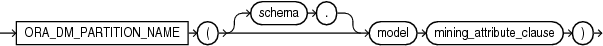

## ORA\_DM\_PARTITION\_NAME

Syntax



> ```
> ORA_DM_PARTITION_NAME ( [ schema . ] model mining_attribute_clause )
> ```
>
> [  
> Copyright © 1996, 2025, Oracle and/or its affiliates.](https://docs.oracle.com/en/database/oracle/oracle-database/dcommon/html/cpyr.htm)


mining\_attribute\_clause::=


> ```
> USING
> { * 
> | { [ schema . ] table . * 
>   | expr [ AS alias ]
>   }
>     [, { [ schema . ] table . * 
>        | expr [ AS alias ]
>        }
>     ]...
> }
> ```
>
> [  
> Copyright © 1996, 2025, Oracle and/or its affiliates.](https://docs.oracle.com/en/database/oracle/oracle-database/dcommon/html/cpyr.htm)


Purpose

`ORA_DM_PARTITION_NAME` is a single row function that works along with other existing functions. This function returns the name of the partition associated with the input row. When `ORA_DM_PARTITION_NAME` is used on a non-partitioned model, the result is `NULL`.

The syntax of the `ORA_DM_PARTITION_NAME` function can use an optional `GROUPING` hint when scoring a partitioned model. See [GROUPING Hint](Comments.md).

mining\_attribute\_clause

The `mining_attribute_clause` identifies the column attributes to use as predictors for scoring. When the function is invoked with the analytic syntax, these predictors are also used for building the transient models. The `mining_attribute_clause` behaves as described for the `PREDICTION` function. See [mining\_attribute\_clause](PREDICTION.md).

Note:

The following examples are excerpted from the Oracle Machine Learning for SQL sample programs. For more information about the sample programs, see Appendix A in [Oracle Machine Learning for SQL User’s Guide](https://docs.oracle.com/pls/topic/lookup?ctx=en/database/oracle/oracle-database/21/sqlrf&id=DMPRG714).

Example

```
SELECT prediction(mymodel using *) pred, ora_dm_partition_name(mymodel USING *) pname FROM customers;
```