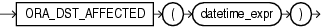

## ORA\_DST\_AFFECTED

Syntax



> ```
> ORA_DST_AFFECTED(datetime_expr)
> ```
>
> [  
> Copyright © 1996, 2025, Oracle and/or its affiliates.](https://docs.oracle.com/en/database/oracle/oracle-database/dcommon/html/cpyr.htm)


Purpose

`ORA_DST_AFFECTED` is useful when you are changing the time zone data file for your database. The function takes as an argument a datetime expression that resolves to a `TIMESTAMP` `WITH` `TIME` `ZONE` value or a `VARRAY` object that contains `TIMESTAMP` `WITH` `TIME` `ZONE` values. The function returns `1` if the datetime value is affected by or will result in a "nonexisting time" or "duplicate time" error with the new time zone data. Otherwise, it returns 0.

This function can be issued only when changing the time zone data file of the database and upgrading the timestamp with the time zone data, and only between the execution of the `DBMS_DST`.`BEGIN_PREPARE` and the `DBMS_DST`.`END_PREPARE` procedures or between the execution of the `DBMS_DST`.`BEGIN_UPGRADE` and the `DBMS_DST`.`END_UPGRADE` procedures.

See Also:

[Oracle Database Globalization Support Guide](https://docs.oracle.com/pls/topic/lookup?ctx=en/database/oracle/oracle-database/21/sqlrf&id=NLSPG259) for more information on time zone data files and on how Oracle Database handles daylight saving time, and [Oracle Database PL/SQL Packages and Types Reference](https://docs.oracle.com/pls/topic/lookup?ctx=en/database/oracle/oracle-database/21/sqlrf&id=ARPLS234) for information on the `DBMS_DST` package