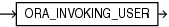

## ORA\_INVOKING\_USER

Syntax



> ```
> ORA_INVOKING_USER
> ```
>
> [  
> Copyright © 1996, 2025, Oracle and/or its affiliates.](https://docs.oracle.com/en/database/oracle/oracle-database/dcommon/html/cpyr.htm)


Purpose

`ORA_INVOKING_USER` returns the name of the database user who invoked the current statement or view. This function takes into account the `BEQUEATH` property of intervening views referenced in the statement. If this function is invoked from within a definer's rights context, then it returns the name of the owner of the definer's rights object. If the invoking user is a Real Application Security user, then it returns user `XS$NULL`.

This function returns a `VARCHAR2` value.

See Also:

- [BEQUEATH](CREATE-VIEW.md) clause of the `CREATE` `VIEW` statement
- [Oracle Database 2 Day + Security Guide](https://docs.oracle.com/pls/topic/lookup?ctx=en/database/oracle/oracle-database/21/sqlrf&id=TDPSG20302) for more information on user `XS$NULL`
- Appendix C in [Oracle Database Globalization Support Guide](https://docs.oracle.com/pls/topic/lookup?ctx=en/database/oracle/oracle-database/21/sqlrf&id=NLSPG-GUID-AFCE41ED-775B-4A00-AF38-C436776AE0C5) for the collation derivation rules, which define the collation assigned to the character return value of `ORA_INVOKING_USER`

Examples

The following example returns the name of the database user who invoked the statement:

```
SELECT ORA_INVOKING_USER FROM DUAL;
```