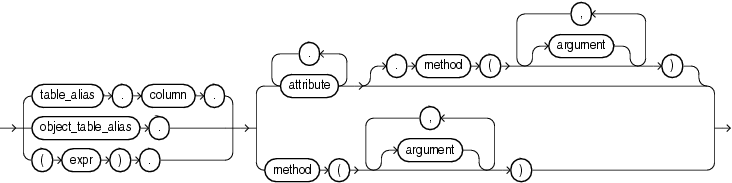

## Object Access Expressions

An object access expression specifies attribute reference and method invocation.

object\_access\_expression::=



> ```
> { table_alias.column.
> | object_table_alias.
> | (expr).
> }
> { attribute [.attribute ]...
>   [.method ([ argument [, argument ]... ]) ]
> | method ([ argument [, argument ]... ])
> }
> ```
>
> [  
> Copyright © 1996, 2025, Oracle and/or its affiliates.](https://docs.oracle.com/en/database/oracle/oracle-database/dcommon/html/cpyr.htm)


The column parameter can be an object or `REF` column. If you specify `expr`, then it must resolve to an object type.

When a type's member function is invoked in the context of a SQL statement, if the `SELF` argument is null, Oracle returns null and the function is not invoked.

Examples

The following example creates a table based on the sample `oe.order_item_typ` object type, and then shows how you would update and select from the object column attributes.

```
CREATE TABLE short_orders (
   sales_rep VARCHAR2(25), item order_item_typ);

UPDATE short_orders s SET sales_rep = 'Unassigned';

SELECT o.item.line_item_id, o.item.quantity FROM short_orders o;
```