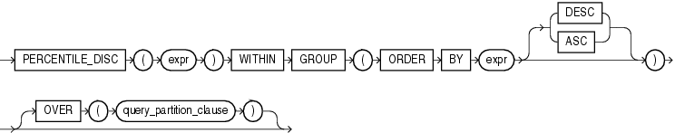

## PERCENTILE\_DISC

Syntax



> ```
> PERCENTILE_DISC(expr) WITHIN GROUP
>    (ORDER BY expr [ DESC | ASC ])
>    [ OVER (query_partition_clause) ]
> ```
>
> [  
> Copyright © 1996, 2025, Oracle and/or its affiliates.](https://docs.oracle.com/en/database/oracle/oracle-database/dcommon/html/cpyr.htm)


See Also:

" [Analytic Functions](Analytic-Functions.md) " for information on syntax, semantics, and restrictions of the `OVER` clause

Purpose

`PERCENTILE_DISC` is an inverse distribution function that assumes a discrete distribution model. It takes a percentile value and a sort specification and returns an element from the set. Nulls are ignored in the calculation.

This function takes as an argument any numeric data type or any nonnumeric data type that can be implicitly converted to a numeric data type. The function returns the same data type as the numeric data type of the argument.

See Also:

[Table 2-8](Data-Type-Comparison-Rules.md) for more information on implicit conversion

The first `expr` must evaluate to a numeric value between 0 and 1, because it is a percentile value. This expression must be constant within each aggregate group. The `ORDER` `BY` clause takes a single expression that can be of any type that can be sorted.

For a given percentile value `P`, `PERCENTILE_DISC` sorts the values of the expression in the `ORDER` `BY` clause and returns the value with the smallest `CUME_DIST` value (with respect to the same sort specification) that is greater than or equal to `P`.

Note:

Before processing a large amount of data with the `PERCENTILE_DISC` function, consider using one of the following methods to obtain approximate results more quickly than exact results:

- Set the `APPROX_FOR_PERCENTILE` initialization parameter to `PERCENTILE_DISC` or `ALL` before using the `PERCENTILE_DISC` function. Refer to [Oracle Database Reference](https://docs.oracle.com/pls/topic/lookup?ctx=en/database/oracle/oracle-database/21/sqlrf&id=REFRN-GUID-3872A78C-9B3F-457C-AD28-4E86F71AE74D) for more information on this parameter.
- Use the `APPROX_PERCENTILE` function instead of the `PERCENTILE_DISC` function. Refer to [APPROX\_PERCENTILE](APPROX_PERCENTILE.md).

Aggregate Example

See aggregate example for [PERCENTILE\_CONT](PERCENTILE_CONT.md).

Analytic Example

The following example calculates the median discrete percentile of the salary of each employee in the sample table `hr.employees`:

```
SELECT last_name, salary, department_id,
       PERCENTILE_DISC(0.5) WITHIN GROUP (ORDER BY salary DESC)
         OVER (PARTITION BY department_id) "Percentile_Disc",
       CUME_DIST() OVER (PARTITION BY department_id 
         ORDER BY salary DESC) "Cume_Dist"
  FROM employees
  WHERE department_id in (30, 60)
  ORDER BY last_name, salary, department_id;

LAST_NAME                     SALARY DEPARTMENT_ID Percentile_Disc  Cume_Dist
------------------------- ---------- ------------- --------------- ----------
Austin                          4800            60            4800         .8
Baida                           2900            30            2900         .5
Colmenares                      2500            30            2900          1
Ernst                           6000            60            4800         .4
Himuro                          2600            30            2900 .833333333
Hunold                          9000            60            4800         .2
Khoo                            3100            30            2900 .333333333
Lorentz                         4200            60            4800          1
Pataballa                       4800            60            4800         .8
Raphaely                       11000            30            2900 .166666667
Tobias                          2800            30            2900 .666666667
```

The median value for Department 30 is 2900, which is the value whose corresponding percentile (`Cume_Dist`) is the smallest value greater than or equal to 0.5. The median value for Department 60 is 4800, which is the value whose corresponding percentile is the smallest value greater than or equal to 0.5.