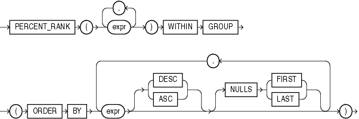
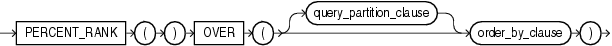

## PERCENT\_RANK

Aggregate Syntax

percent\_rank\_aggregate::=



> ```
> PERCENT_RANK(expr [, expr ]...) WITHIN GROUP
>    (ORDER BY
>     expr [ DESC | ASC ]
>          [NULLS { FIRST | LAST } ]
>     [, expr [ DESC | ASC ]
>             [NULLS { FIRST | LAST } ]
>     ]...
>    )
> ```
>
> [  
> Copyright © 1996, 2025, Oracle and/or its affiliates.](https://docs.oracle.com/en/database/oracle/oracle-database/dcommon/html/cpyr.htm)


Analytic Syntax

percent\_rank\_analytic::=



> ```
> PERCENT_RANK( )
>    OVER ([ query_partition_clause ] order_by_clause)
> ```
>
> [  
> Copyright © 1996, 2025, Oracle and/or its affiliates.](https://docs.oracle.com/en/database/oracle/oracle-database/dcommon/html/cpyr.htm)


See Also:

" [Analytic Functions](Analytic-Functions.md) " for information on syntax, semantics, and restrictions

Purpose

`PERCENT_RANK` is similar to the `CUME_DIST` (cumulative distribution) function. The range of values returned by `PERCENT_RANK` is 0 to 1, inclusive. The first row in any set has a `PERCENT_RANK` of 0. The return value is `NUMBER`.

See Also:

[Table 2-8](Data-Type-Comparison-Rules.md) for more information on implicit conversion

- As an aggregate function, `PERCENT_RANK` calculates, for a hypothetical row `r` identified by the arguments of the function and a corresponding sort specification, the rank of row `r` minus 1 divided by the number of rows in the aggregate group. This calculation is made as if the hypothetical row `r` were inserted into the group of rows over which Oracle Database is to aggregate.
	The arguments of the function identify a single hypothetical row within each aggregate group. Therefore, they must all evaluate to constant expressions within each aggregate group. The constant argument expressions and the expressions in the `ORDER` `BY` clause of the aggregate match by position. Therefore the number of arguments must be the same and their types must be compatible.
- As an analytic function, for a row `r`, `PERCENT_RANK` calculates the rank of `r` minus 1, divided by 1 less than the number of rows being evaluated (the entire query result set or a partition).

See Also:

Appendix C in [Oracle Database Globalization Support Guide](https://docs.oracle.com/pls/topic/lookup?ctx=en/database/oracle/oracle-database/21/sqlrf&id=NLSPG-GUID-AFCE41ED-775B-4A00-AF38-C436776AE0C5) for the collation determination rules, which define the collation `PERCENT_RANK` uses to compare character values for the `ORDER` `BY` clause

Aggregate Example

The following example calculates the percent rank of a hypothetical employee in the sample table `hr.employees` with a salary of $15,500 and a commission of 5%:

```
SELECT PERCENT_RANK(15000, .05) WITHIN GROUP
       (ORDER BY salary, commission_pct) "Percent-Rank" 
  FROM employees;

Percent-Rank
------------
  .971962617
```

Analytic Example

The following example calculates, for each employee, the percent rank of the employee's salary within the department:

```
SELECT department_id, last_name, salary, PERCENT_RANK() 
       OVER (PARTITION BY department_id ORDER BY salary DESC) AS pr
  FROM employees
  ORDER BY pr, salary, last_name;

DEPARTMENT_ID LAST_NAME                     SALARY         PR
------------- ------------------------- ---------- ----------
           10 Whalen                          4400          0
           40 Mavris                          6500          0
              Grant                           7000          0
. . .
           80 Vishney                        10500 .181818182
           80 Zlotkey                        10500 .181818182
           30 Khoo                            3100         .2
. . .
           50 Markle                          2200 .954545455
           50 Philtanker                      2200 .954545455
           50 Olson                           2100          1
. . .
```