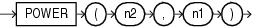

## POWER

Syntax



> ```
> POWER(n2, n1)
> ```
>
> [  
> Copyright © 1996, 2025, Oracle and/or its affiliates.](https://docs.oracle.com/en/database/oracle/oracle-database/dcommon/html/cpyr.htm)


Purpose

`POWER` returns `n2` raised to the `n1` power. The base `n2` and the exponent `n1` can be any numbers, but if `n2` is negative, then `n1` must be an integer.

This function takes as arguments any numeric data type or any nonnumeric data type that can be implicitly converted to a numeric data type. If any argument is `BINARY_FLOAT` or `BINARY_DOUBLE`, then the function returns `BINARY_DOUBLE`. Otherwise, the function returns `NUMBER`.

See Also:

[Table 2-8](Data-Type-Comparison-Rules.md) for more information on implicit conversion

Examples

The following example returns 3 squared:

```
SELECT POWER(3,2) "Raised"
  FROM DUAL;

    Raised
----------
         9
```