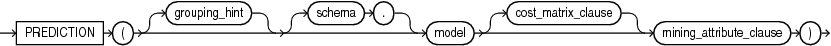
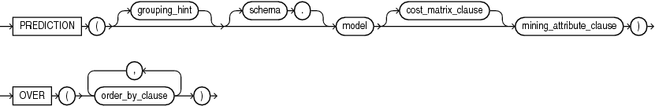
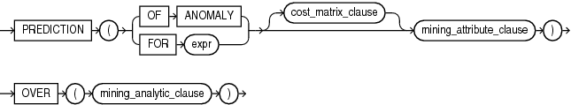

## PREDICTION

Syntax

prediction::=



> ```
> PREDICTION ( [ grouping_hint ] [ schema . ] model
>   [ cost_matrix_clause ] mining_attribute_clause )
> ```
>
> [  
> Copyright © 1996, 2025, Oracle and/or its affiliates.](https://docs.oracle.com/en/database/oracle/oracle-database/dcommon/html/cpyr.htm)


prediction\_ordered::=



> ```
> PREDICTION ( ( [ grouping_hint ] [ schema .] model ) [ cost_matrix_clause ] mining_attribute_clause )
>             OVER ( order_by_clause [, order_by_clause ]... )
> ```
>
> [  
> Copyright © 1996, 2025, Oracle and/or its affiliates.](https://docs.oracle.com/en/database/oracle/oracle-database/dcommon/html/cpyr.htm)


Analytic Syntax

prediction\_analytic::=



> ```
> PREDICTION ( ( OF ANOMALY | FOR expr ) [ cost_matrix_clause ] mining_attribute_clause )
>             OVER ( mining_analytic_clause )
> ```
>
> [  
> Copyright © 1996, 2025, Oracle and/or its affiliates.](https://docs.oracle.com/en/database/oracle/oracle-database/dcommon/html/cpyr.htm)


cost\_matrix\_clause::=


> ```
> COST
>   { MODEL [AUTO]
>   | ( class_value [, class_value]... )
>         VALUES ( ( cost_value [, cost_value]...) 
>                  [ , (cost_value [, cost_value]... ) ]...
>                )
>   }
> ```
>
> [  
> Copyright © 1996, 2025, Oracle and/or its affiliates.](https://docs.oracle.com/en/database/oracle/oracle-database/dcommon/html/cpyr.htm)


mining\_attribute\_clause::=


> ```
> USING
> { * 
> | { [ schema . ] table . * 
>   | expr [ AS alias ]
>   }
>     [, { [ schema . ] table . * 
>        | expr [ AS alias ]
>        }
>     ]...
> }
> ```
>
> [  
> Copyright © 1996, 2025, Oracle and/or its affiliates.](https://docs.oracle.com/en/database/oracle/oracle-database/dcommon/html/cpyr.htm)


mining\_analytic\_clause::=


> ```
> [ query_partition_clause ] [ order_by_clause ]
> ```
>
> [  
> Copyright © 1996, 2025, Oracle and/or its affiliates.](https://docs.oracle.com/en/database/oracle/oracle-database/dcommon/html/cpyr.htm)


See Also:

" [Analytic Functions](Analytic-Functions.md) " for information on the syntax, semantics, and restrictions of `mining_analytic_clause`

Purpose

`PREDICTION` returns a prediction for each row in the selection. The data type of the returned prediction depends on whether the function performs Regression, Classification, or Anomaly Detection.

- Regression: Returns the expected target value for each row. The data type of the return value is the data type of the target.
- Classification: Returns the most probable target class (or lowest cost target class, if costs are specified) for each row. The data type of the return value is the data type of the target.
- Anomaly Detection: Returns `1` or `0` for each row. Typical rows are classified as 1. Rows that differ significantly from the rest of the data are classified as 0.

cost\_matrix\_clause

Costs are a biasing factor for minimizing the most harmful kinds of misclassifications. You can specify `cost_matrix_clause` for Classification or Anomaly Detection. Costs are not relevant for Regression. The `cost_matrix_clause` behaves as described for " [PREDICTION\_COST](PREDICTION_COST.md) ".

Syntax Choice

`PREDICTION` can score data by applying a mining model object to the data, or it can dynamically score the data by executing an analytic clause that builds and applies one or more transient mining models. Choose Syntax or Analytic Syntax:

- Syntax: Use the `prediction` syntax to score the data with a pre-defined model. Supply the name of a model that performs classification, regression, or anomaly detection.
	Use the `prediction_ordered` syntax for a model that requires ordered data, such as an MSET-SPRT model. The `prediction_ordered` syntax requires an `order_by_clause` clause.
	Restrictions on the `prediction_ordered` syntax are that you cannot use it in the `WHERE` clause of a query. Also, you cannot use a `query_partition_clause` or a `windowing_clause` with the `prediction_ordered` syntax.
	For details about the `order_by_clause`, see " [Analytic Functions](Analytic-Functions.md) ".
- Analytic Syntax: Use the analytic syntax to score the data without a pre-defined model. The analytic syntax uses `mining_analytic_clause`, which specifies if the data should be partitioned for multiple model builds. The `mining_analytic_clause` supports a `query_partition_clause` and an `order_by_clause`. (See " [analytic\_clause::=](Analytic-Functions.md) ".)
	- For Regression, specify `FOR` `expr`, where `expr` is an expression that identifies a target column that has a numeric data type.
		- For Classification, specify `FOR` `expr`, where `expr` is an expression that identifies a target column that has a character data type.
		- For Anomaly Detection, specify the keywords `OF ANOMALY`.

The syntax of the `PREDICTION` function can use an optional `GROUPING` hint when scoring a partitioned model. See [GROUPING Hint](Comments.md).

mining\_attribute\_clause

`mining_attribute_clause` identifies the column attributes to use as predictors for scoring.

- If you specify `USING *`, all the relevant attributes present in the input row are used.
- If you invoke the function with the analytic syntax, the `mining_attribute_clause` is used both for building the transient models and for scoring.
- It you invoke the function with a pre-defined model, the `mining_attribute_clause` should include all or some of the attributes that were used to create the model. The following conditions apply:
	- If `mining_attribute_clause` includes an attribute with the same name but a different data type from the one that was used to create the model, then the data type is converted to the type expected by the model.
		- If you specify more attributes for scoring than were used to create the model, then the extra attributes are silently ignored.
		- If you specify fewer attributes for scoring than were used to create the model, then scoring is performed on a best-effort basis.

See Also:

- [Oracle Machine Learning for SQL User’s Guide](https://docs.oracle.com/pls/topic/lookup?ctx=en/database/oracle/oracle-database/21/sqlrf&id=DMPRG004) for information about scoring.
- [Oracle Machine Learning for SQL Concepts](https://docs.oracle.com/pls/topic/lookup?ctx=en/database/oracle/oracle-database/21/sqlrf&id=DMCON042) for information about predictive Oracle Machine Learning for SQL.
- Appendix C in [Oracle Database Globalization Support Guide](https://docs.oracle.com/pls/topic/lookup?ctx=en/database/oracle/oracle-database/21/sqlrf&id=NLSPG-GUID-AFCE41ED-775B-4A00-AF38-C436776AE0C5) for the collation derivation rules, which define the collation assigned to the return value of `PREDICTION` when it is a character value

Note:

The following examples are excerpted from the Oracle Machine Learning for SQL sample programs. For more information about the sample programs, see Appendix A in [Oracle Machine Learning for SQL User’s Guide](https://docs.oracle.com/pls/topic/lookup?ctx=en/database/oracle/oracle-database/21/sqlrf&id=DMPRG714).

Example

In this example, the model `dt_sh_clas_sample` predicts the gender and age of customers who are most likely to use an affinity card (target = 1). The `PREDICTION` function takes into account the cost matrix associated with the model and uses marital status, education, and household size as predictors.

```
SELECT cust_gender, COUNT(*) AS cnt, ROUND(AVG(age)) AS avg_age
   FROM mining_data_apply_v
   WHERE PREDICTION(dt_sh_clas_sample COST MODEL
      USING cust_marital_status, education, household_size) = 1
   GROUP BY cust_gender
   ORDER BY cust_gender;
   
CUST_GENDER         CNT    AVG_AGE
------------ ---------- ----------
F                   170         38
M                   685         42
```

The cost matrix associated with the model `dt_sh_clas_sample` is stored in the table `dt_sh_sample_costs`. The cost matrix specifies that the misclassification of 1 is 8 times more costly than the misclassification of 0.

```
SQL> select * from dt_sh_sample_cost;
 
ACTUAL_TARGET_VALUE PREDICTED_TARGET_VALUE         COST
------------------- ---------------------- ------------
                  0                      0   .000000000
                  0                      1  1.000000000
                  1                      0  8.000000000
                  1                      1   .000000000
```

Analytic Example

In this example, dynamic regression is used to predict the age of customers who are likely to use an affinity card. The query returns the 3 customers whose predicted age is most different from the actual. The query includes information about the predictors that have the greatest influence on the prediction.

```
SELECT cust_id, age, pred_age, age-pred_age age_diff, pred_det FROM
   (SELECT cust_id, age, pred_age, pred_det,
          RANK() OVER (ORDER BY ABS(age-pred_age) desc) rnk FROM
   (SELECT cust_id, age,
           PREDICTION(FOR age USING *) OVER () pred_age,
           PREDICTION_DETAILS(FOR age ABS USING *) OVER () pred_det
    FROM mining_data_apply_v))
  WHERE rnk <= 3;
 
CUST_ID  AGE PRED_AGE AGE_DIFF PRED_DET
------- ---- -------- -------- -------- ----------------------------------------------------------
 100910   80    40.67    39.33 <Details algorithm="Support Vector Machines">
                               <Attribute name="HOME_THEATER_PACKAGE" actualValue="1" weight=".059"
                                rank="1"/>
                               <Attribute name="Y_BOX_GAMES" actualValue="0" weight=".059"
                                rank="2"/>
                               <Attribute name="AFFINITY_CARD" actualValue="0" weight=".059"
                                rank="3"/>
                               <Attribute name="FLAT_PANEL_MONITOR" actualValue="1" weight=".059"
                                rank="4"/>
                               <Attribute name="YRS_RESIDENCE" actualValue="4" weight=".059"
                                rank="5"/>
                               </Details>
 
 101285    79   42.18    36.82 <Details algorithm="Support Vector Machines">
                               <Attribute name="HOME_THEATER_PACKAGE" actualValue="1" weight=".059"
                                rank="1"/>
                               <Attribute name="HOUSEHOLD_SIZE" actualValue="2" weight=".059"
                                rank="2"/>
                               <Attribute name="CUST_MARITAL_STATUS" actualValue="Mabsent"
                                weight=".059" rank="3"/>
                               <Attribute name="Y_BOX_GAMES" actualValue="0" weight=".059"
                                rank="4"/>
                               <Attribute name="OCCUPATION" actualValue="Prof." weight=".059"
                                rank="5"/>
                               </Details>
 
 100694     77  41.04    35.96 <Details algorithm="Support Vector Machines">
                               <Attribute name="HOME_THEATER_PACKAGE" actualValue="1" weight=".059"
                                rank="1"/>
                               <Attribute name="EDUCATION" actualValue="&lt; Bach." weight=".059"
                                rank="2"/>
                               <Attribute name="Y_BOX_GAMES" actualValue="0" weight=".059"
                                rank="3"/>
                               <Attribute name="CUST_ID" actualValue="100694" weight=".059"
                                rank="4"/>
                               <Attribute name="COUNTRY_NAME" actualValue="United States of
                                America" weight=".059" rank="5"/>
                               </Details>
```