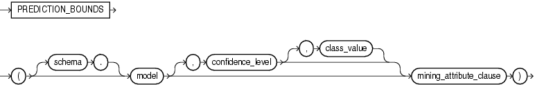

## PREDICTION\_BOUNDS

Syntax



> ```
> PREDICTION_BOUNDS ( [schema.] model [, confidence_level [, class_value]] 
>                     mining_attribute_clause )
> ```
>
> [  
> Copyright © 1996, 2025, Oracle and/or its affiliates.](https://docs.oracle.com/en/database/oracle/oracle-database/dcommon/html/cpyr.htm)


mining\_attribute\_clause::=


> ```
> USING
> { * 
> | { [ schema . ] table . * 
>   | expr [ AS alias ]
>   }
>     [, { [ schema . ] table . * 
>        | expr [ AS alias ]
>        }
>     ]...
> }
> ```
>
> [  
> Copyright © 1996, 2025, Oracle and/or its affiliates.](https://docs.oracle.com/en/database/oracle/oracle-database/dcommon/html/cpyr.htm)


Purpose

`PREDICTION_BOUNDS` applies a Generalized Linear Model (GLM) to predict a class or a value for each row in the selection. The function returns the upper and lower bounds of each prediction in a varray of objects with fields `UPPER` and `LOWER`.

GLM can perform either regression or binary classification:

- The bounds for regression refer to the predicted target value. The data type of `UPPER` and `LOWER` is the data type of the target.
- The bounds for binary classification refer to the probability of either the predicted target class or the specified `class_value`. The data type of `UPPER` and `LOWER` is `BINARY_DOUBLE`.

If the model was built using ridge regression, or if the covariance matrix is found to be singular during the build, then `PREDICTION_BOUNDS` returns `NULL` for both bounds.

`confidence_level` is a number in the range (0,1). The default value is 0.95. You can specify `class_value` while leaving `confidence_level` at its default by specifying `NULL` for `confidence_level`.

The syntax of the `PREDICTION_BOUNDS` function can use an optional `GROUPING` hint when scoring a partitioned model. See [GROUPING Hint](Comments.md).

mining\_attribute\_clause

`mining_attribute_clause` identifies the column attributes to use as predictors for scoring. This clause behaves as described for the `PREDICTION` function. (Note that the reference to analytic syntax does not apply.) See " [mining\_attribute\_clause::=](PREDICTION.md) ".

See Also:

- [Oracle Machine Learning for SQL User’s Guide](https://docs.oracle.com/pls/topic/lookup?ctx=en/database/oracle/oracle-database/21/sqlrf&id=DMPRG004) for information about scoring
- [Oracle Machine Learning for SQL Concepts](https://docs.oracle.com/pls/topic/lookup?ctx=en/database/oracle/oracle-database/21/sqlrf&id=DMCON022) for information about Generalized Linear Models

Note:

The following example is excerpted from the Oracle Machine Learning for SQL sample programs. For more information about the sample programs, see Appendix A in [Oracle Machine Learning for SQL User’s Guide](https://docs.oracle.com/pls/topic/lookup?ctx=en/database/oracle/oracle-database/21/sqlrf&id=DMPRG714).

Example

The following example returns the distribution of customers whose ages are predicted with 98% confidence to be greater than 24 and less than 46.

```
SELECT count(cust_id) cust_count, cust_marital_status
  FROM (SELECT cust_id, cust_marital_status
    FROM mining_data_apply_v
    WHERE PREDICTION_BOUNDS(glmr_sh_regr_sample,0.98 USING *).LOWER > 24 AND
          PREDICTION_BOUNDS(glmr_sh_regr_sample,0.98 USING *).UPPER < 46)
    GROUP BY cust_marital_status;
 
    CUST_COUNT CUST_MARITAL_STATUS
-------------- --------------------
            46 NeverM
             7 Mabsent
             5 Separ.
            35 Divorc.
            72 Married
```