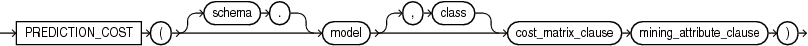
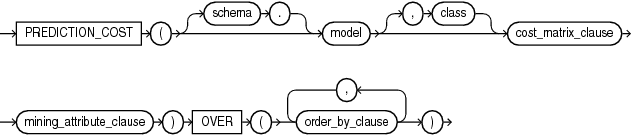
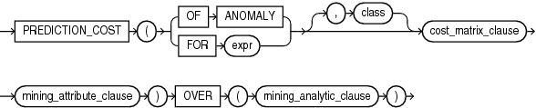

## PREDICTION\_COST

Syntax

prediction\_cost::=



> ```
> PREDICTION_COST ( [ schema . ] model [ , class ] cost_matrix_clause mining_attribute_clause )
> ```
>
> [  
> Copyright © 1996, 2025, Oracle and/or its affiliates.](https://docs.oracle.com/en/database/oracle/oracle-database/dcommon/html/cpyr.htm)


prediction\_cost\_ordered::=



> ```
> PREDICTION_COST ( [ schema . ] model [ , class ] cost_matrix_clause mining_attribute_clause )
>   OVER ( order_by_clause [, order_by_clause ]... )
> ```
>
> [  
> Copyright © 1996, 2025, Oracle and/or its affiliates.](https://docs.oracle.com/en/database/oracle/oracle-database/dcommon/html/cpyr.htm)


Analytic Syntax

prediction\_cost\_analytic::=



> ```
> PREDICTION_COST ( ( OF ANOMALY | FOR expr ) [ , class ]
>                   cost_matrix_clause mining_attribute_clause )
>                 OVER (mining_analytic_clause)
> ```
>
> [  
> Copyright © 1996, 2025, Oracle and/or its affiliates.](https://docs.oracle.com/en/database/oracle/oracle-database/dcommon/html/cpyr.htm)


cost\_matrix\_clause::=


> ```
> COST
>   { MODEL [AUTO]
>   | ( class_value [, class_value]... )
>         VALUES ( ( cost_value [, cost_value]...) 
>                  [ , (cost_value [, cost_value]... ) ]...
>                )
>   }
> ```
>
> [  
> Copyright © 1996, 2025, Oracle and/or its affiliates.](https://docs.oracle.com/en/database/oracle/oracle-database/dcommon/html/cpyr.htm)


mining\_attribute\_clause::=


> ```
> USING
> { * 
> | { [ schema . ] table . * 
>   | expr [ AS alias ]
>   }
>     [, { [ schema . ] table . * 
>        | expr [ AS alias ]
>        }
>     ]...
> }
> ```
>
> [  
> Copyright © 1996, 2025, Oracle and/or its affiliates.](https://docs.oracle.com/en/database/oracle/oracle-database/dcommon/html/cpyr.htm)


mining\_analytic\_clause::=


> ```
> [ query_partition_clause ] [ order_by_clause ]
> ```
>
> [  
> Copyright © 1996, 2025, Oracle and/or its affiliates.](https://docs.oracle.com/en/database/oracle/oracle-database/dcommon/html/cpyr.htm)


See Also:

" [Analytic Functions](Analytic-Functions.md) " for information on the syntax, semantics, and restrictions of `mining_analytic_clause`

Purpose

`PREDICTION_COST` returns a cost for each row in the selection. The cost refers to the lowest cost class or to the specified `class`. The cost is returned as `BINARY_DOUBLE`.

`PREDICTION_COST` can perform classification or anomaly detection. For classification, the returned cost refers to a predicted target class. For anomaly detection, the returned cost refers to a classification of `1` (for typical rows) or `0` (for anomalous rows).

You can use `PREDICTION_COST` in conjunction with the `PREDICTION` function to obtain the prediction and the cost of the prediction.

cost\_matrix\_clause

Costs are a biasing factor for minimizing the most harmful kinds of misclassifications. For example, false positives might be considered more costly than false negatives. Costs are specified in a cost matrix that can be associated with the model or defined inline in a `VALUES` clause. All classification algorithms can use costs to influence scoring.

Decision Tree is the only algorithm that can use costs to influence the model build. The cost matrix used to build a Decision Tree model is also the default scoring cost matrix for the model.

The following cost matrix table specifies that the misclassification of `1` is five times more costly than the misclassification of `0`.

```
ACTUAL_TARGET_VALUE PREDICTED_TARGET_VALUE       COST
------------------- ---------------------- ----------
                  0                      0          0
                  0                      1          1
                  1                      0          5
                  1                      1          0
```

In `cost_matrix_clause`:

- `COST` `MODEL` indicates that scoring should be performed by taking into account the scoring cost matrix associated with the model. If the cost matrix does not exist, then the function returns an error.
- `COST` `MODEL` `AUTO` indicates that the existence of a cost matrix is unknown. If a cost matrix exists, then the function uses it to return the lowest cost prediction. Otherwise the function returns the highest probability prediction.
- The `VALUES` clause specifies an inline cost matrix for `class_value`. For example, you could specify that the misclassification of `1` is five times more costly than the misclassification of `0` as follows:
	```
	PREDICTION (nb_model COST (0,1) VALUES ((0, 1),(1, 5)) USING *)
	```
	If a model that has a scoring cost matrix is invoked with an inline cost matrix, then the inline costs are used.
	See Also:
	[Oracle Machine Learning for SQL User’s Guide](https://docs.oracle.com/pls/topic/lookup?ctx=en/database/oracle/oracle-database/21/sqlrf&id=DMPRG243) for more information about cost-sensitive prediction.

Syntax Choice

`PREDICTION_COST` can score the data by applying a mining model object to the data, or it can dynamically mine the data by executing an analytic clause that builds and applies one or more transient mining models. Choose Syntax or Analytic Syntax:

- Syntax: Use the `prediction_cost` syntax to score the data with a pre-defined model. Supply the name of a model that performs classification or anomaly detection.
	Use the `prediction_cost_ordered` syntax for a model that requires ordered data, such as an MSET-SPRT model. The `prediction_cost_ordered` syntax requires an `order_by_clause` clause.
	Restrictions on the `prediction_cost_ordered` syntax are that you cannot use it in the `WHERE` clause of a query. Also, you cannot use a `query_partition_clause` or a `windowing_clause` with the `prediction_ordered` syntax.
- Analytic Syntax: Use the analytic syntax to score the data without a pre-defined model. The analytic syntax uses `mining_analytic_clause`, which specifies if the data should be partitioned for multiple model builds. The `mining_analytic_clause` supports a `query_partition_clause` and an `order_by_clause`. (See " [analytic\_clause::=](Analytic-Functions.md) ".)
	- For classification, specify `FOR` `expr`, where `expr` is an expression that identifies a target column that has a character data type.
		- For anomaly detection, specify the keywords `OF ANOMALY`.

The syntax of the `PREDICTION_COST` function can use an optional `GROUPING` hint when scoring a partitioned model. See [GROUPING Hint](Comments.md).

mining\_attribute\_clause

`mining_attribute_clause` identifies the column attributes to use as predictors for scoring. When the function is invoked with the analytic syntax, these predictors are also used for building the transient models. The `mining_attribute_clause` behaves as described for the `PREDICTION` function. (See " [mining\_attribute\_clause::=](PREDICTION.md) ".)

See Also:

- [Oracle Machine Learning for SQL User’s Guide](https://docs.oracle.com/pls/topic/lookup?ctx=en/database/oracle/oracle-database/21/sqlrf&id=DMPRG004) for information about scoring.
- [Oracle Machine Learning for SQL Concepts](https://docs.oracle.com/pls/topic/lookup?ctx=en/database/oracle/oracle-database/21/sqlrf&id=DMCON050) for information about classification with costs

Note:

The following example is excerpted from the Oracle Machine Learning for SQL sample programs. For more information about the sample programs, see Appendix A in [Oracle Machine Learning for SQL User’s Guide](https://docs.oracle.com/pls/topic/lookup?ctx=en/database/oracle/oracle-database/21/sqlrf&id=DMPRG714).

Example

This example predicts the ten customers in Italy who would respond to the least expensive sales campaign (offering an affinity card).

```
SELECT cust_id 
FROM (SELECT cust_id,rank()
       OVER (ORDER BY PREDICTION_COST(DT_SH_Clas_sample, 1 COST MODEL USING *)
            ASC, cust_id) rnk
        FROM mining_data_apply_v
        WHERE country_name = 'Italy')
  WHERE rnk <= 10
  ORDER BY rnk;
 
   CUST_ID
----------
    100081
    100179
    100185
    100324
    100344
    100554
    100662
    100733
    101250
    101306
```