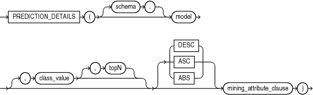
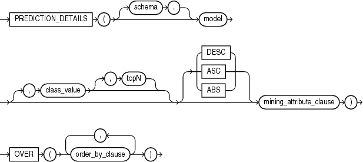
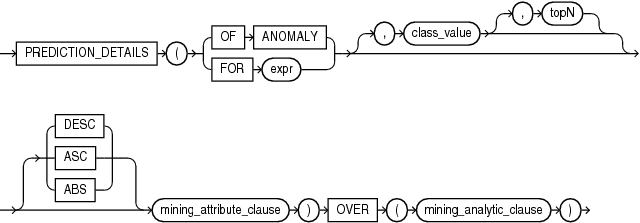

## PREDICTION\_DETAILS

Syntax

prediction\_details::=



> ```
> PREDICTION_DETAILS ( [ schema . ] model 
>                      [ , class_value [ , topN ] ] [ DESC | ASC | ABS ]
>                      mining_attribute_clause )
> ```
>
> [  
> Copyright © 1996, 2025, Oracle and/or its affiliates.](https://docs.oracle.com/en/database/oracle/oracle-database/dcommon/html/cpyr.htm)


prediction\_details\_ordered::=



> ```
> PREDICTION_DETAILS ( [ schema . ] model 
>                            [ , class_value [ , topN ] ] [ DESC | ASC | ABS ]
>                            mining_attribute_clause )
>   OVER ( order_by_clause [, order_by_clause ]... )
> ```
>
> [  
> Copyright © 1996, 2025, Oracle and/or its affiliates.](https://docs.oracle.com/en/database/oracle/oracle-database/dcommon/html/cpyr.htm)


Analytic Syntax

prediction\_details\_analytic::=



> ```
> PREDICTION_DETAILS ( ( OF ANOMALY | FOR expr ) [ , class_value [ , topN ] ]
>                      [ DESC | ASC | ABS ] mining_attribute_clause )
>                    OVER ( mining_analytic_clause )
> ```
>
> [  
> Copyright © 1996, 2025, Oracle and/or its affiliates.](https://docs.oracle.com/en/database/oracle/oracle-database/dcommon/html/cpyr.htm)


mining\_attribute\_clause::=


> ```
> USING
> { * 
> | { [ schema . ] table . * 
>   | expr [ AS alias ]
>   }
>     [, { [ schema . ] table . * 
>        | expr [ AS alias ]
>        }
>     ]...
> }
> ```
>
> [  
> Copyright © 1996, 2025, Oracle and/or its affiliates.](https://docs.oracle.com/en/database/oracle/oracle-database/dcommon/html/cpyr.htm)


mining\_analytic\_clause::=


> ```
> [ query_partition_clause ] [ order_by_clause ]
> ```
>
> [  
> Copyright © 1996, 2025, Oracle and/or its affiliates.](https://docs.oracle.com/en/database/oracle/oracle-database/dcommon/html/cpyr.htm)


See Also:

" [Analytic Functions](Analytic-Functions.md) " for information on the syntax, semantics, and restrictions of `mining_analytic_clause`

Purpose

`PREDICTION_DETAILS` returns prediction details for each row in the selection. The return value is an XML string that describes the attributes of the prediction.

For regression, the returned details refer to the predicted target value. For classification and anomaly detection, the returned details refer to the highest probability class or the specified `class_value`.

topN

If you specify a value for `topN`, the function returns the `N` attributes that have the most influence on the prediction (the score). If you do not specify `topN`, the function returns the 5 most influential attributes.

DESC, ASC, or ABS

The returned attributes are ordered by weight. The weight of an attribute expresses its positive or negative impact on the prediction. For regression, a positive weight indicates a higher value prediction; a negative weight indicates a lower value prediction. For classification and anomaly detection, a positive weight indicates a higher probability prediction; a negative weight indicates a lower probability prediction.

By default, `PREDICTION_DETAILS` returns the attributes with the highest positive weight (`DESC`). If you specify `ASC`, the attributes with the highest negative weight are returned. If you specify `ABS`, the attributes with the greatest weight, whether negative or positive, are returned. The results are ordered by absolute value from highest to lowest. Attributes with a zero weight are not included in the output.

Syntax Choice

`PREDICTION_DETAILS` can score the data by applying a mining model object to the data, or it can dynamically mine the data by executing an analytic clause that builds and applies one or more transient mining models. Choose Syntax or Analytic Syntax:

- Syntax: Use the `prediction_details` syntax to score the data with a pre-defined model. Supply the name of a model that performs classification, regression, or anomaly detection.
	Use the `prediction_details_ordered` syntax for a model that requires ordered data, such as an MSET-SPRT model. The `prediction_details_ordered` syntax requires an `order_by_clause` clause.
	Restrictions on the `prediction_details_ordered` syntax are that you cannot use it in the `WHERE` clause of a query. Also, you cannot use a `query_partition_clause` or a `windowing_clause` with the `prediction_details_ordered` syntax.
- Analytic Syntax: Use the analytic syntax to score the data without a pre-defined model. The analytic syntax uses `mining_analytic_clause`, which specifies if the data should be partitioned for multiple model builds. The `mining_analytic_clause` supports a `query_partition_clause` and an `order_by_clause`. (See " [analytic\_clause::=](Analytic-Functions.md) ".)
	- For classification, specify `FOR` `expr`, where `expr` is an expression that identifies a target column that has a character data type.
		- For regression, specify `FOR` `expr`, where `expr` is an expression that identifies a target column that has a numeric data type.
		- For anomaly detection, specify the keywords `OF ANOMALY`.

The syntax of the `PREDICTION_DETAILS` function can use an optional `GROUPING` hint when scoring a partitioned model. See [GROUPING Hint](Comments.md).

mining\_attribute\_clause

`mining_attribute_clause` identifies the column attributes to use as predictors for scoring. When the function is invoked with the analytic syntax, these predictors are also used for building the transient models. The `mining_attribute_clause` behaves as described for the `PREDICTION` function. (See " [mining\_attribute\_clause::=](PREDICTION.md) ".)

See Also:

- [Oracle Machine Learning for SQL User’s Guide](https://docs.oracle.com/pls/topic/lookup?ctx=en/database/oracle/oracle-database/21/sqlrf&id=DMPRG004) for information about scoring.
- [Oracle Machine Learning for SQL Concepts](https://docs.oracle.com/pls/topic/lookup?ctx=en/database/oracle/oracle-database/21/sqlrf&id=DMCON042) for information about predictive Oracle Machine Learning for SQL.

Note:

The following examples are excerpted from the Oracle Machine Learning for SQL sample programs. For more information about the sample programs, see Appendix A in [Oracle Machine Learning for SQL User’s Guide](https://docs.oracle.com/pls/topic/lookup?ctx=en/database/oracle/oracle-database/21/sqlrf&id=DMPRG714).

Example

This example uses the model `svmr_sh_regr_sample` to score the data. The query returns the three attributes that have the greatest influence on predicting a higher value for customer age.

```
SELECT PREDICTION_DETAILS(svmr_sh_regr_sample, null, 3 USING *) prediction_details
    FROM mining_data_apply_v
    WHERE cust_id = 100001;
 
PREDICTION_DETAILS
---------------------------------------------------------------------------------------
<Details algorithm="Support Vector Machines">
<Attribute name="CUST_MARITAL_STATUS" actualValue="Widowed" weight=".361" rank="1"/>
<Attribute name="CUST_GENDER" actualValue="F" weight=".14" rank="2"/>
<Attribute name="HOME_THEATER_PACKAGE" actualValue="1" weight=".135" rank="3"/>
</Details>
```

Analytic Syntax

This example dynamically identifies customers whose age is not typical for the data. The query returns the attributes that predict or detract from a typical age.

```
SELECT cust_id, age, pred_age, age-pred_age age_diff, pred_det
    FROM (SELECT cust_id, age, pred_age, pred_det,
          RANK() OVER (ORDER BY ABS(age-pred_age) DESC) rnk
          FROM (SELECT cust_id, age,
             PREDICTION(FOR age USING *) OVER () pred_age,
             PREDICTION_DETAILS(FOR age ABS USING *) OVER () pred_det
             FROM mining_data_apply_v))
    WHERE rnk <= 5;
 
CUST_ID AGE PRED_AGE AGE_DIFF  PRED_DET
------- --- -------- -------- ------------------------------------------------------------------
 100910  80    40.67    39.33 <Details algorithm="Support Vector Machines">
                              <Attribute name="HOME_THEATER_PACKAGE" actualValue="1" weight=".059"
                               rank="1"/>
                              <Attribute name="Y_BOX_GAMES" actualValue="0" weight=".059"
                               rank="2"/>
                              <Attribute name="AFFINITY_CARD" actualValue="0" weight=".059"
                               rank="3"/>
                              <Attribute name="FLAT_PANEL_MONITOR" actualValue="1" weight=".059"
                               rank="4"/>
                              <Attribute name="YRS_RESIDENCE" actualValue="4" weight=".059"
                               rank="5"/>
                              </Details>
 
 101285  79    42.18    36.82  <Details algorithm="Support Vector Machines">
                               <Attribute name="HOME_THEATER_PACKAGE" actualValue="1" weight=".059"
                                rank="1"/>
                               <Attribute name="HOUSEHOLD_SIZE" actualValue="2" weight=".059"
                                rank="2"/>
                               <Attribute name="CUST_MARITAL_STATUS" actualValue="Mabsent"
                                weight=".059" rank="3"/>
                               <Attribute name="Y_BOX_GAMES" actualValue="0" weight=".059"
                                rank="4"/>
                               <Attribute name="OCCUPATION" actualValue="Prof." weight=".059"
                                rank="5"/>
                               </Details>
 
 100694   77    41.04    35.96  <Details algorithm="Support Vector Machines">
                                <Attribute name="HOME_THEATER_PACKAGE" actualValue="1"
                                 weight=".059" rank="1"/>
                                <Attribute name="EDUCATION" actualValue="&lt; Bach." weight=".059"
                                 rank="2"/>
                                <Attribute name="Y_BOX_GAMES" actualValue="0" weight=".059"
                                 rank="3"/>
                                <Attribute name="CUST_ID" actualValue="100694" weight=".059"
                                 rank="4"/>
                                <Attribute name="COUNTRY_NAME" actualValue="United States of
                                 America" weight=".059" rank="5"/>
                                </Details>
 
 100308  81    45.33    35.67  <Details algorithm="Support Vector Machines">
                               <Attribute name="HOME_THEATER_PACKAGE" actualValue="1" weight=".059"
                                rank="1"/>
                               <Attribute name="Y_BOX_GAMES" actualValue="0" weight=".059"
                                rank="2"/>
                               <Attribute name="HOUSEHOLD_SIZE" actualValue="2" weight=".059"
                                rank="3"/>
                               <Attribute name="FLAT_PANEL_MONITOR" actualValue="1" weight=".059"
                                rank="4"/>
                               <Attribute name="CUST_GENDER" actualValue="F" weight=".059"
                                rank="5"/>
                               </Details>
 
 101256  90    54.39    35.61  <Details algorithm="Support Vector Machines">
                               <Attribute name="YRS_RESIDENCE" actualValue="9" weight=".059"
                                rank="1"/>
                               <Attribute name="HOME_THEATER_PACKAGE" actualValue="1" weight=".059"
                                rank="2"/>
                               <Attribute name="EDUCATION" actualValue="&lt; Bach." weight=".059"
                                rank="3"/>
                               <Attribute name="Y_BOX_GAMES" actualValue="0" weight=".059"
                                rank="4"/>
                               <Attribute name="COUNTRY_NAME" actualValue="United States of
                                America" weight=".059" rank="5"/>
                               </Details>
```