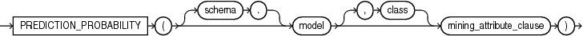
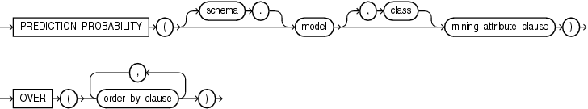
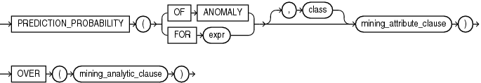

## PREDICTION\_PROBABILITY

Syntax

prediction\_probability::=



> ```
> PREDICTION_PROBABILITY ( [ schema . ] model [ , class ] mining_attribute_clause )
> ```
>
> [  
> Copyright © 1996, 2025, Oracle and/or its affiliates.](https://docs.oracle.com/en/database/oracle/oracle-database/dcommon/html/cpyr.htm)


prediction\_probability\_ordered::=



> ```
> PREDICTION_PROBABILITY ( [ schema . ] model [ , class ] mining_attribute_clause )
>   OVER ( order_by_clause [, order_by_clause ]... )
> ```
>
> [  
> Copyright © 1996, 2025, Oracle and/or its affiliates.](https://docs.oracle.com/en/database/oracle/oracle-database/dcommon/html/cpyr.htm)


Analytic Syntax

prediction\_prob\_analytic::=



> ```
> PREDICTION_PROBABILITY ( ( OF ANOMALY | FOR expr ) [ , class ]
>                          mining_attribute_clause )
>                        OVER (mining_analytic_clause )
> ```
>
> [  
> Copyright © 1996, 2025, Oracle and/or its affiliates.](https://docs.oracle.com/en/database/oracle/oracle-database/dcommon/html/cpyr.htm)


mining\_attribute\_clause::=


> ```
> USING
> { * 
> | { [ schema . ] table . * 
>   | expr [ AS alias ]
>   }
>     [, { [ schema . ] table . * 
>        | expr [ AS alias ]
>        }
>     ]...
> }
> ```
>
> [  
> Copyright © 1996, 2025, Oracle and/or its affiliates.](https://docs.oracle.com/en/database/oracle/oracle-database/dcommon/html/cpyr.htm)


mining\_analytic\_clause::=


> ```
> [ query_partition_clause ] [ order_by_clause ]
> ```
>
> [  
> Copyright © 1996, 2025, Oracle and/or its affiliates.](https://docs.oracle.com/en/database/oracle/oracle-database/dcommon/html/cpyr.htm)


See Also:

" [Analytic Functions](Analytic-Functions.md) " for information on the syntax, semantics, and restrictions of `mining_analytic_clause`

Purpose

`PREDICTION_PROBABILITY` returns a probability for each row in the selection. The probability refers to the highest probability class or to the specified `class`. The data type of the returned probability is `BINARY_DOUBLE`.

`PREDICTION_PROBABILITY` can perform classification or anomaly detection. For classification, the returned probability refers to a predicted target class. For anomaly detection, the returned probability refers to a classification of `1` (for typical rows) or `0` (for anomalous rows).

You can use `PREDICTION_PROBABILITY` in conjunction with the `PREDICTION` function to obtain the prediction and the probability of the prediction.

Syntax Choice

`PREDICTION_PROBABILITY` can score the data by applying a mining model object to the data, or it can dynamically mine the data by executing an analytic clause that builds and applies one or more transient mining models. Choose Syntax or Analytic Syntax:

- Syntax: Use the `prediction_probability` syntax to score the data with a pre-defined model. Supply the name of a model that performs classification or anomaly detection.
	Use the `prediction_probability_ordered` syntax for a model that requires ordered data, such as an MSET-SPRT model. The `prediction_probability_ordered` syntax requires an `order_by_clause` clause.
	Restrictions on the `prediction_probability_ordered` syntax are that you cannot use it in the `WHERE` clause of a query. Also, you cannot use a `query_partition_clause` or a `windowing_clause` with the `prediction_probability_ordered` syntax.
- Analytic Syntax: Use the analytic syntax to score the data without a pre-defined model. The analytic syntax uses `mining_analytic_clause`, which specifies if the data should be partitioned for multiple model builds. The `mining_analytic_clause` supports a `query_partition_clause` and an `order_by_clause`. (See " [analytic\_clause::=](Analytic-Functions.md) ".)
	- For classification, specify `FOR` `expr`, where `expr` is an expression that identifies a target column that has a character data type.
		- For anomaly detection, specify the keywords `OF ANOMALY`.

The syntax of the `PREDICTION_PROBABILITY` function can use an optional `GROUPING` hint when scoring a partitioned model. See [GROUPING Hint](Comments.md).

mining\_attribute\_clause

`mining_attribute_clause` identifies the column attributes to use as predictors for scoring. When the function is invoked with the analytic syntax, these predictors are also used for building the transient models. The `mining_attribute_clause` behaves as described for the `PREDICTION` function. (See " [mining\_attribute\_clause::=](PREDICTION.md) ".)

See Also:

- [Oracle Machine Learning for SQL User’s Guide](https://docs.oracle.com/pls/topic/lookup?ctx=en/database/oracle/oracle-database/21/sqlrf&id=DMPRG004) for information about scoring.
- [Oracle Machine Learning for SQL Concepts](https://docs.oracle.com/pls/topic/lookup?ctx=en/database/oracle/oracle-database/21/sqlrf&id=DMCON042) for information about predictive Oracle Machine Learning for SQL.

Note:

The following examples are excerpted from the Oracle Machine Learning for SQL sample programs. For information about the sample programs, see Appendix A in [Oracle Machine Learning for SQL User’s Guide](https://docs.oracle.com/pls/topic/lookup?ctx=en/database/oracle/oracle-database/21/sqlrf&id=DMPRG714).

Example

The following example returns the 10 customers living in Italy who are most likely to use an affinity card.

```
SELECT cust_id FROM (
   SELECT cust_id
   FROM mining_data_apply_v
   WHERE country_name = 'Italy'
   ORDER BY PREDICTION_PROBABILITY(DT_SH_Clas_sample, 1 USING *)
      DESC, cust_id)
   WHERE rownum < 11;
 
   CUST_ID
----------
    100081
    100179
    100185
    100324
    100344
    100554
    100662
    100733
    101250
    101306
```

Analytic Example

This example identifies rows that are most atypical in the data in `mining_data_one_class_v`. Each type of marital status is considered separately so that the most anomalous rows per marital status group are returned.

The query returns three attributes that have the most influence on the determination of anomalous rows. The `PARTITION BY` clause causes separate models to be built and applied for each marital status. Because there is only one record with status Mabsent, no model is created for that partition (and no details are provided).

```
SELECT cust_id, cust_marital_status, rank_anom, anom_det FROM
    (SELECT cust_id, cust_marital_status, anom_det,
            rank() OVER (PARTITION BY CUST_MARITAL_STATUS
                         ORDER BY ANOM_PROB DESC,cust_id) rank_anom FROM
     (SELECT cust_id, cust_marital_status,
            PREDICTION_PROBABILITY(OF ANOMALY, 0 USING *)
              OVER (PARTITION BY CUST_MARITAL_STATUS) anom_prob,
            PREDICTION_DETAILS(OF ANOMALY, 0, 3 USING *)
              OVER (PARTITION BY CUST_MARITAL_STATUS) anom_det
     FROM mining_data_one_class_v
    ))
   WHERE rank_anom < 3 order by 2, 3;

CUST_ID CUST_MARITAL_STATUS RANK_ANOM  ANOM_DET
------- ------------------- ---------- -----------------------------------------------------------
102366  Divorc.             1          <Details algorithm="Support Vector Machines" class="0">
                                       <Attribute name="COUNTRY_NAME" actualValue="United Kingdom"
                                        weight=".069" rank="1"/>
                                       <Attribute name="AGE" actualValue="28" weight=".013"
                                        rank="2"/>
                                       <Attribute name="YRS_RESIDENCE" actualValue="4"
                                        weight=".006" rank="3"/>
                                       </Details>

101817  Divorc.             2          <Details algorithm="Support Vector Machines" class="0">
                                       <Attribute name="YRS_RESIDENCE" actualValue="8"
                                        weight=".018" rank="1"/>
                                       <Attribute name="EDUCATION" actualValue="PhD" weight=".007"
                                        rank="2"/>
                                       <Attribute name="CUST_INCOME_LEVEL" actualValue="K:
                                        250\,000 - 299\,999" weight=".006" rank="3"/>
                                       </Details>
 
101713  Mabsent             1
 
101790  Married             1          <Details algorithm="Support Vector Machines" class="0">
                                       <Attribute name="COUNTRY_NAME" actualValue="Canada"
                                        weight=".063" rank="1"/>
                                       <Attribute name="EDUCATION" actualValue="7th-8th"
                                        weight=".011" rank="2"/>
                                       <Attribute name="HOUSEHOLD_SIZE" actualValue="4-5"
                                        weight=".011" rank="3"/>
                                       </Details>
. . .
```