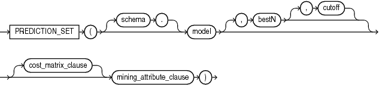
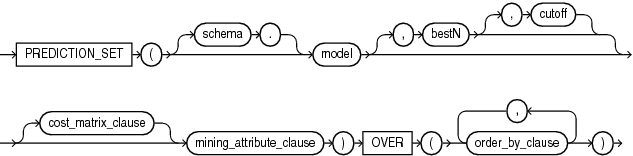
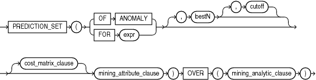

## PREDICTION\_SET

Syntax

prediction\_set::=



> ```
> PREDICTION_SET ( [ schema . ] model [ , bestN [ , cutoff ] ] 
>                  [ cost_matrix_clause ] mining_attribute_clause )
> ```
>
> [  
> Copyright © 1996, 2025, Oracle and/or its affiliates.](https://docs.oracle.com/en/database/oracle/oracle-database/dcommon/html/cpyr.htm)


prediction\_set\_ordered::=



> ```
> PREDICTION_SET ( [ schema . ] model [ , bestN [ , cutoff ] ] 
>                  [ cost_matrix_clause ] mining_attribute_clause )
>   OVER ( order_by_clause [, order_by_clause ]... )
> ```
>
> [  
> Copyright © 1996, 2025, Oracle and/or its affiliates.](https://docs.oracle.com/en/database/oracle/oracle-database/dcommon/html/cpyr.htm)


Analytic Syntax

prediction\_set\_analytic::=



> ```
> PREDICTION_SET ( ( OF ANOMALY | FOR "expr" ) [ , bestN [ , cutoff ] ]
>                  [ cost_matrix_clause ] mining_attribute_clause )
>                OVER ( mining_analytic_clause )
> ```
>
> [  
> Copyright © 1996, 2025, Oracle and/or its affiliates.](https://docs.oracle.com/en/database/oracle/oracle-database/dcommon/html/cpyr.htm)


cost\_matrix\_clause::=


> ```
> COST
>   { MODEL [AUTO]
>   | ( class_value [, class_value]... )
>         VALUES ( ( cost_value [, cost_value]...) 
>                  [ , (cost_value [, cost_value]... ) ]...
>                )
>   }
> ```
>
> [  
> Copyright © 1996, 2025, Oracle and/or its affiliates.](https://docs.oracle.com/en/database/oracle/oracle-database/dcommon/html/cpyr.htm)


mining\_attribute\_clause::=


> ```
> USING
> { * 
> | { [ schema . ] table . * 
>   | expr [ AS alias ]
>   }
>     [, { [ schema . ] table . * 
>        | expr [ AS alias ]
>        }
>     ]...
> }
> ```
>
> [  
> Copyright © 1996, 2025, Oracle and/or its affiliates.](https://docs.oracle.com/en/database/oracle/oracle-database/dcommon/html/cpyr.htm)


mining\_analytic\_clause::-


> ```
> [ query_partition_clause ] [ order_by_clause ]
> ```
>
> [  
> Copyright © 1996, 2025, Oracle and/or its affiliates.](https://docs.oracle.com/en/database/oracle/oracle-database/dcommon/html/cpyr.htm)


See Also:

" [Analytic Functions](Analytic-Functions.md) " for information on the syntax, semantics, and restrictions of `mining_analytic_clause`

Purpose

`PREDICTION_SET` returns a set of predictions with either probabilities or costs for each row in the selection. The return value is a varray of objects with field names `PREDICTION_ID` and `PROBABILITY` or `COST`. The prediction identifier has the data type of the target; the probability and cost fields are `BINARY_DOUBLE`.

`PREDICTION_SET` can perform classification or anomaly detection. For classification, the return value refers to a predicted target class. For anomaly detection, the return value refers to a classification of `1` (for typical rows) or `0` (for anomalous rows).

bestN and cutoff

You can specify `bestN` and `cutoff` to limit the number of predictions returned by the function. By default, both `bestN` and `cutoff` are null and all predictions are returned.

- `bestN` is the `N` predictions that are either the most probable or the least costly. If multiple predictions share the `N` th probability or cost, then the function chooses one of them.
- `cutoff` is a value threshold. Only predictions with probability greater than or equal to `cutoff`, or with cost less than or equal to `cutoff`, are returned. To filter by `cutoff` only, specify `NULL` for `bestN`. If the function uses a `cost_matrix_clause` with `COST MODEL AUTO`, then `cutoff` is ignored.

You can specify `bestN` with `cutoff` to return up to the `N` most probable predictions that are greater than or equal to `cutoff`. If costs are used, specify `bestN` with `cutoff` to return up to the `N` least costly predictions that are less than or equal to cutoff.

cost\_matrix\_clause

You can specify `cost_matrix_clause` as a biasing factor for minimizing the most harmful kinds of misclassifications. `cost_matrix_clause` behaves as described for " [PREDICTION\_COST](PREDICTION_COST.md) ".

Syntax Choice

`PREDICTION_SET` can score the data by applying a mining model object to the data, or it can dynamically mine the data by executing an analytic clause that builds and applies one or more transient mining models. Choose Syntax or Analytic Syntax:

- Syntax: Use the `prediction_set` syntax to score the data with a pre-defined model. Supply the name of a model that performs classification or anomaly detection.
	Use the `prediction_set_ordered` syntax for a model that requires ordered data, such as an MSET-SPRT model. The `prediction_set_ordered` syntax requires an `order_by_clause` clause.
	Restrictions on the `prediction_set_ordered` syntax are that you cannot use it in the `WHERE` clause of a query. Also, you cannot use a `query_partition_clause` or a `windowing_clause` with the `prediction_set_ordered` syntax.
- Analytic Syntax: Use the analytic syntax to score the data without a pre-defined model. The analytic syntax uses `mining_analytic_clause`, which specifies if the data should be partitioned for multiple model builds. The `mining_analytic_clause` supports a `query_partition_clause` and an `order_by_clause`. (See " [analytic\_clause::=](Analytic-Functions.md) ".)
	- For classification, specify `FOR` `expr`, where `expr` is an expression that identifies a target column that has a character data type.
		- For anomaly detection, specify the keywords `OF ANOMALY`.

The syntax of the `PREDICTION_SET` function can use an optional `GROUPING` hint when scoring a partitioned model. See [GROUPING Hint](Comments.md).

mining\_attribute\_clause

`mining_attribute_clause` identifies the column attributes to use as predictors for scoring. When the function is invoked with the analytic syntax, these predictors are also used for building the transient models. The `mining_attribute_clause` behaves as described for the `PREDICTION` function. (See " [mining\_attribute\_clause::=](PREDICTION.md) ".)

See Also:

- [Oracle Machine Learning for SQL User’s Guide](https://docs.oracle.com/pls/topic/lookup?ctx=en/database/oracle/oracle-database/21/sqlrf&id=DMPRG004) for information about scoring.
- [Oracle Machine Learning for SQL Concepts](https://docs.oracle.com/pls/topic/lookup?ctx=en/database/oracle/oracle-database/21/sqlrf&id=DMCON042) for information about predictive Oracle Machine Learning for SQL.

Note:

The following example is excerpted from the Oracle Machine Learning for SQL sample programs. For more information about the sample programs, see Appendix A in [Oracle Machine Learning for SQL User’s Guide](https://docs.oracle.com/pls/topic/lookup?ctx=en/database/oracle/oracle-database/21/sqlrf&id=DMPRG714).

Example

This example lists the probability and cost that customers with ID less than 100006 will use an affinity card. This example has a binary target, but such a query is also useful for multiclass classification such as low, medium, and high.

```
SELECT T.cust_id, S.prediction, S.probability, S.cost
  FROM (SELECT cust_id,
               PREDICTION_SET(dt_sh_clas_sample COST MODEL USING *) pset
          FROM mining_data_apply_v
         WHERE cust_id < 100006) T,
       TABLE(T.pset) S
ORDER BY cust_id, S.prediction;
 
   CUST_ID PREDICTION  PROBABILITY         COST
---------- ---------- ------------ ------------
    100001          0   .966183575   .270531401
    100001          1   .033816425   .966183575
    100002          0   .740384615  2.076923077
    100002          1   .259615385   .740384615
    100003          0   .909090909   .727272727
    100003          1   .090909091   .909090909
    100004          0   .909090909   .727272727
    100004          1   .090909091   .909090909
    100005          0   .272357724  5.821138211
    100005          1   .727642276   .272357724
```