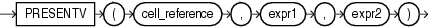

## PRESENTV

Syntax



> ```
> PRESENTV(cell_reference, expr1, expr2)
> ```
>
> [  
> Copyright © 1996, 2025, Oracle and/or its affiliates.](https://docs.oracle.com/en/database/oracle/oracle-database/dcommon/html/cpyr.htm)


Purpose

The `PRESENTV` function can be used only within the `model_clause` of the `SELECT` statement and then only on the right-hand side of a model rule. It returns `expr1` when, prior to the execution of the `model_clause`, `cell_reference` exists. Otherwise it returns `expr2`.

See Also:

- [model\_clause](SELECT.md) and " [Model Expressions](Model-Expressions.md) " for the syntax and semantics
- Appendix C in [Oracle Database Globalization Support Guide](https://docs.oracle.com/pls/topic/lookup?ctx=en/database/oracle/oracle-database/21/sqlrf&id=NLSPG-GUID-AFCE41ED-775B-4A00-AF38-C436776AE0C5) for the collation derivation rules, which define the collation assigned to the return value of `PRESENTV` when it is a character value

Examples

In the following example, if a row containing sales for the Mouse Pad for the year 2000 exists, then the sales value for the Mouse Pad for the year 2001 is set to the sales value for the Mouse Pad for the year 2000. If the row does not exist, then a row is created with the sales value for the Mouse Pad for year 20001 set to 0.

```
SELECT country, prod, year, s
  FROM sales_view_ref
  MODEL
    PARTITION BY (country)
    DIMENSION BY (prod, year)
    MEASURES (sale s)
    IGNORE NAV
    UNIQUE DIMENSION
    RULES UPSERT SEQUENTIAL ORDER
    (
      s['Mouse Pad', 2001] =
        PRESENTV(s['Mouse Pad', 2000], s['Mouse Pad', 2000], 0)
    )
  ORDER BY country, prod, year;

COUNTRY       PROD                                         YEAR           S
----------    -----------------------------------      --------   ---------
France        Mouse Pad                                    1998     2509.42
France        Mouse Pad                                    1999     3678.69
France        Mouse Pad                                    2000     3000.72
France        Mouse Pad                                    2001     3000.72
France        Standard Mouse                               1998     2390.83
France        Standard Mouse                               1999     2280.45
France        Standard Mouse                               2000     1274.31
France        Standard Mouse                               2001     2164.54
Germany       Mouse Pad                                    1998     5827.87
Germany       Mouse Pad                                    1999     8346.44
Germany       Mouse Pad                                    2000     7375.46
Germany       Mouse Pad                                    2001     7375.46
Germany       Standard Mouse                               1998     7116.11
Germany       Standard Mouse                               1999     6263.14
Germany       Standard Mouse                               2000     2637.31
Germany       Standard Mouse                               2001     6456.13

16 rows selected.
```

The preceding example requires the view `sales_view_ref`. Refer to " [The MODEL clause: Examples](SELECT.md) " to create this view.