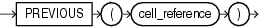

## PREVIOUS

Syntax



> ```
> PREVIOUS(cell_reference)
> ```
>
> [  
> Copyright © 1996, 2025, Oracle and/or its affiliates.](https://docs.oracle.com/en/database/oracle/oracle-database/dcommon/html/cpyr.htm)


Purpose

The `PREVIOUS` function can be used only in the `model_clause` of the `SELECT` statement and then only in the `ITERATE`... \[ `UNTIL` `]` clause of the `model_rules_clause`. It returns the value of `cell_reference` at the beginning of each iteration.

See Also:

- [model\_clause](SELECT.md) and " [Model Expressions](Model-Expressions.md) " for the syntax and semantics
- Appendix C in [Oracle Database Globalization Support Guide](https://docs.oracle.com/pls/topic/lookup?ctx=en/database/oracle/oracle-database/21/sqlrf&id=NLSPG-GUID-AFCE41ED-775B-4A00-AF38-C436776AE0C5) for the collation derivation rules, which define the collation assigned to the return value of `PREVIOUS` when it is a character value

Examples

The following example repeats the rules, up to 1000 times, until the difference between the values of `cur_val` at the beginning and at the end of an iteration is less than one:

```
SELECT dim_col, cur_val, num_of_iterations
  FROM (SELECT 1 AS dim_col, 10 AS cur_val FROM dual)
  MODEL
    DIMENSION BY (dim_col)
    MEASURES (cur_val, 0 num_of_iterations)
    IGNORE NAV
    UNIQUE DIMENSION
    RULES ITERATE (1000) UNTIL (PREVIOUS(cur_val[1]) - cur_val[1] < 1)
    (
      cur_val[1] = cur_val[1]/2,
      num_of_iterations[1] = num_of_iterations[1] + 1
    );

   DIM_COL    CUR_VAL NUM_OF_ITERATIONS
---------- ---------- -----------------
         1       .625                 4
```