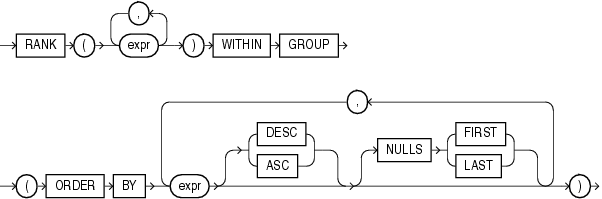
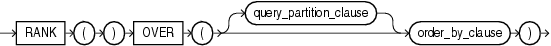

## RANK

Aggregate Syntax

rank\_aggregate::=



> ```
> RANK(expr [, expr ]...) WITHIN GROUP
>    (ORDER BY
>     expr [ DESC | ASC ]
>          [ NULLS { FIRST | LAST } ]
>     [, expr [ DESC | ASC ]
>             [ NULLS { FIRST | LAST } ]
>     ]...
>    )
> ```
>
> [  
> Copyright © 1996, 2025, Oracle and/or its affiliates.](https://docs.oracle.com/en/database/oracle/oracle-database/dcommon/html/cpyr.htm)


Analytic Syntax

rank\_analytic::=



> ```
> RANK( )
>    OVER ([ query_partition_clause ] order_by_clause)
> ```
>
> [  
> Copyright © 1996, 2025, Oracle and/or its affiliates.](https://docs.oracle.com/en/database/oracle/oracle-database/dcommon/html/cpyr.htm)


See Also:

" [Analytic Functions](Analytic-Functions.md) " for information on syntax, semantics, and restrictions

Purpose

`RANK` calculates the rank of a value in a group of values. The return type is `NUMBER`.

See Also:

[Table 2-8](Data-Type-Comparison-Rules.md) for more information on implicit conversion and " [Numeric Precedence](Data-Types.md) " for information on numeric precedence

Rows with equal values for the ranking criteria receive the same rank. Oracle Database then adds the number of tied rows to the tied rank to calculate the next rank. Therefore, the ranks may not be consecutive numbers. This function is useful for top-N and bottom-N reporting.

- As an aggregate function, `RANK` calculates the rank of a hypothetical row identified by the arguments of the function with respect to a given sort specification. The arguments of the function must all evaluate to constant expressions within each aggregate group, because they identify a single row within each group. The constant argument expressions and the expressions in the `ORDER` `BY` clause of the aggregate match by position. Therefore, the number of arguments must be the same and their types must be compatible.
- As an analytic function, `RANK` computes the rank of each row returned from a query with respect to the other rows returned by the query, based on the values of the `value_exprs` in the `order_by_clause`.

See Also:

Appendix C in [Oracle Database Globalization Support Guide](https://docs.oracle.com/pls/topic/lookup?ctx=en/database/oracle/oracle-database/21/sqlrf&id=NLSPG-GUID-AFCE41ED-775B-4A00-AF38-C436776AE0C5) for the collation determination rules, which define the collation `RANK` uses to compare character values for the `ORDER` `BY` clause

Aggregate Example

The following example calculates the rank of a hypothetical employee in the sample table `hr.employees` with a salary of $15,500 and a commission of 5%:

```
SELECT RANK(15500, .05) WITHIN GROUP
   (ORDER BY salary, commission_pct) "Rank"
   FROM employees;

      Rank
----------
       105
```

Similarly, the following query returns the rank for a $15,500 salary among the employee salaries:

```
SELECT RANK(15500) WITHIN GROUP 
   (ORDER BY salary DESC) "Rank of 15500" 
   FROM employees;

Rank of 15500
--------------
             4
```

Analytic Example

The following statement ranks the employees in the sample `hr` schema in department 60 based on their salaries. Identical salary values receive the same rank and cause nonconsecutive ranks. Compare this example with the analytic example for [DENSE\_RANK](DENSE_RANK.md).

```
SELECT department_id, last_name, salary,
       RANK() OVER (PARTITION BY department_id ORDER BY salary) RANK
  FROM employees WHERE department_id = 60
  ORDER BY RANK, last_name;

DEPARTMENT_ID LAST_NAME                     SALARY       RANK
------------- ------------------------- ---------- ----------
           60 Lorentz                         4200          1
           60 Austin                          4800          2
           60 Pataballa                       4800          2
           60 Ernst                           6000          4
           60 Hunold                          9000          5
```