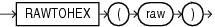

## RAWTOHEX

Syntax



> ```
> RAWTOHEX(raw)
> ```
>
> [  
> Copyright © 1996, 2025, Oracle and/or its affiliates.](https://docs.oracle.com/en/database/oracle/oracle-database/dcommon/html/cpyr.htm)


Purpose

`RAWTOHEX` converts `raw` to a character value containing its hexadecimal representation.

As a SQL built-in function, `RAWTOHEX` accepts an argument of any scalar data type other than `LONG`, `LONG` `RAW`, `CLOB`, `NCLOB`, `BLOB`, or `BFILE`. If the argument is of a data type other than `RAW`, then this function converts the argument value, which is represented using some number of data bytes, into a `RAW` value with the same number of data bytes. The data itself is not modified in any way, but the data type is recast to a `RAW` data type.

This function returns a `VARCHAR2` value with the hexadecimal representation of bytes that make up the value of `raw`. Each byte is represented by two hexadecimal digits.

Note:

`RAWTOHEX` functions differently when used as a PL/SQL built-in function. Refer to [Oracle Database Development Guide](https://docs.oracle.com/pls/topic/lookup?ctx=en/database/oracle/oracle-database/21/sqlrf&id=ADFNS00308) for more information.

See Also:

Appendix C in [Oracle Database Globalization Support Guide](https://docs.oracle.com/pls/topic/lookup?ctx=en/database/oracle/oracle-database/21/sqlrf&id=NLSPG-GUID-AFCE41ED-775B-4A00-AF38-C436776AE0C5) for the collation derivation rules, which define the collation assigned to the character return value of `RAWTOHEX`

Examples

The following hypothetical example returns the hexadecimal equivalent of a `RAW` column value:

```
SELECT RAWTOHEX(raw_column) "Graphics"
   FROM graphics;

Graphics
--------
7D
```

See Also:

" [RAW and LONG RAW Data Types](Data-Types.md) " and [HEXTORAW](HEXTORAW.md)