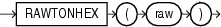

## RAWTONHEX

Syntax



> ```
> RAWTONHEX(raw)
> ```
>
> [  
> Copyright © 1996, 2025, Oracle and/or its affiliates.](https://docs.oracle.com/en/database/oracle/oracle-database/dcommon/html/cpyr.htm)


Purpose

`RAWTONHEX` converts `raw` to a character value containing its hexadecimal representation. `RAWTONHEX(``raw``)` is equivalent to `TO_NCHAR(RAWTOHEX(``raw``))`. The value returned is always in the national character set.

Note:

`RAWTONHEX` functions differently when used as a PL/SQL built-in function. Refer to [Oracle Database Development Guide](https://docs.oracle.com/pls/topic/lookup?ctx=en/database/oracle/oracle-database/21/sqlrf&id=ADFNS00308) for more information.

Examples

The following hypothetical example returns the hexadecimal equivalent of a `RAW` column value:

```
SELECT RAWTONHEX(raw_column),
   DUMP ( RAWTONHEX (raw_column) ) "DUMP" 
   FROM graphics; 

RAWTONHEX(RA)           DUMP 
----------------------- ------------------------------ 
7D                      Typ=1 Len=4: 0,55,0,68
```