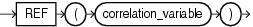

## REF

Syntax



> ```
> REF (correlation_variable)
> ```
>
> [  
> Copyright © 1996, 2025, Oracle and/or its affiliates.](https://docs.oracle.com/en/database/oracle/oracle-database/dcommon/html/cpyr.htm)


Purpose

`REF` takes as its argument a correlation variable (table alias) associated with a row of an object table or an object view. A `REF` value is returned for the object instance that is bound to the variable or row.

Examples

The sample schema `oe` contains a type called `cust_address_typ`, described as follows:

```
Attribute                                 Type
----------------------------- ----------------
STREET_ADDRESS                    VARCHAR2(40)
POSTAL_CODE                       VARCHAR2(10)
CITY                              VARCHAR2(30)
STATE_PROVINCE                    VARCHAR2(10)
COUNTRY_ID                             CHAR(2)
```

The following example creates a table based on the sample type `oe.cust_address_typ`, inserts a row into the table, and retrieves a `REF` value for the object instance of the type in the addresses table:

```
CREATE TABLE addresses OF cust_address_typ;

INSERT INTO addresses VALUES (
   '123 First Street', '4GF H1J', 'Our Town', 'Ourcounty', 'US');

SELECT REF(e) FROM addresses e;

REF(E)
-----------------------------------------------------------------------------------
00002802097CD1261E51925B60E0340800208254367CD1261E51905B60E034080020825436010101820000
```

See Also:

[Oracle Database Object-Relational Developer's Guide](https://docs.oracle.com/pls/topic/lookup?ctx=en/database/oracle/oracle-database/21/sqlrf&id=ADOBJ00805) for information on `REF` s