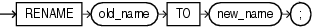

## RENAME

Purpose

Note:

You cannot roll back a `RENAME` statement.

Use the `RENAME` statement to rename a table, view, sequence, or private synonym.

- Oracle Database automatically transfers integrity constraints, indexes, and grants on the old object to the new object.
- Oracle Database invalidates all objects that depend on the renamed object, such as views, synonyms, and stored procedures and functions that refer to a renamed table.

See Also:

[CREATE SYNONYM](CREATE-SYNONYM.md) and [DROP SYNONYM](DROP-SYNONYM.md)

Prerequisites

The object must be in your own schema.

Syntax

rename::=



> ```
> RENAME old_name TO new_name ;
> ```
>
> [  
> Copyright © 1996, 2025, Oracle and/or its affiliates.](https://docs.oracle.com/en/database/oracle/oracle-database/dcommon/html/cpyr.htm)


Semantics

old\_name

Specify the name of an existing table, view, sequence, or private synonym.

new\_name

Specify the new name to be given to the existing object. The new name must not already be used by another schema object in the same namespace and must follow the rules for naming schema objects.

Restrictions on Renaming Objects

Renaming objects is subject to the following restrictions:

- You cannot rename a public synonym. Instead, drop the public synonym and then re-create the public synonym with the new name.
- You cannot rename a type synonym that has any dependent tables or dependent valid user-defined object types.

See Also:

" [Database Object Naming Rules](Database-Object-Names-and-Qualifiers.md) "

Examples

Renaming a Database Object: Example

The following example uses a copy of the sample table `hr.departments`. To change the name of table `departments_new` to `emp_departments`, issue the following statement:

```
RENAME departments_new TO emp_departments;
```

You cannot use this statement directly to rename columns. However, you can rename a column using the `ALTER` `TABLE`... `rename_column_clause`.

See Also:

[rename\_column\_clause](ALTER-TABLE.md)

Another way to rename a column is to use the `RENAME` statement together with the `CREATE` `TABLE` statement with `AS` `subquery`. This method is useful if you are changing the structure of a table rather than only renaming a column. The following statements re-create the sample table `hr.job_history`, renaming a column from `department_id` to `dept_id`:

```
CREATE TABLE temporary 
   (employee_id, start_date, end_date, job_id, dept_id) 
AS SELECT 
     employee_id, start_date, end_date, job_id, department_id
FROM job_history; 

DROP TABLE job_history; 

RENAME temporary TO job_history;
```

Any integrity constraints defined on table `job_history` will be lost in the preceding example. You will have to redefine them on the new `job_history` table using an `ALTER` `TABLE` statement.