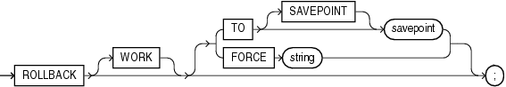

## ROLLBACK

Purpose

Use the `ROLLBACK` statement to undo work done in the current transaction or to manually undo the work done by an in-doubt distributed transaction.

Note:

Oracle recommends that you explicitly end transactions in application programs using either a `COMMIT` or `ROLLBACK` statement. If you do not explicitly commit the transaction and the program terminates abnormally, then Oracle Database rolls back the last uncommitted transaction.

See Also:

- [Oracle Database Concepts](https://docs.oracle.com/pls/topic/lookup?ctx=en/database/oracle/oracle-database/21/sqlrf&id=CNCPT117) for information on transactions
- [Oracle Database Heterogeneous Connectivity User's Guide](https://docs.oracle.com/pls/topic/lookup?ctx=en/database/oracle/oracle-database/21/sqlrf&id=HETER006) for information on distributed transactions
- [SET TRANSACTION](SET-TRANSACTION.md) for information on setting characteristics of the current transaction
- [COMMIT](COMMIT.md) and [SAVEPOINT](SAVEPOINT.md)

Prerequisites

To roll back your current transaction, no privileges are necessary.

To manually roll back an in-doubt distributed transaction that you originally committed, you must have the `FORCE` `TRANSACTION` system privilege. To manually roll back an in-doubt distributed transaction originally committed by another user, you must have the `FORCE` `ANY` `TRANSACTION` system privilege.

Syntax

rollback::=



> ```
> ROLLBACK [ WORK ]
>    [ TO [ SAVEPOINT ] savepoint
>    | FORCE string
>    ] ;
> ```
>
> [  
> Copyright © 1996, 2025, Oracle and/or its affiliates.](https://docs.oracle.com/en/database/oracle/oracle-database/dcommon/html/cpyr.htm)


Semantics

WORK

The keyword `WORK` is optional and is provided for SQL standard compatibility.

TO SAVEPOINT Clause

Specify the savepoint to which you want to roll back the current transaction. If you omit this clause, then the `ROLLBACK` statement rolls back the entire transaction.

Using `ROLLBACK` without the `TO` `SAVEPOINT` clause performs the following operations:

- Ends the transaction
- Undoes all changes in the current transaction
- Erases all savepoints in the transaction
- Releases any transaction locks

See Also:

[SAVEPOINT](SAVEPOINT.md)

Using `ROLLBACK` with the `TO` `SAVEPOINT` clause performs the following operations:

- Rolls back just the portion of the transaction after the savepoint. It does not end the transaction.
- Erases all savepoints created after that savepoint. The named savepoint is retained, so you can roll back to the same savepoint multiple times. Prior savepoints are also retained.
- Releases all table and row locks acquired since the savepoint. Other transactions that have requested access to rows locked after the savepoint must continue to wait until the transaction is committed or rolled back. Other transactions that have not already requested the rows can request and access the rows immediately.

Restriction on In-doubt Transactions

You cannot manually roll back an in-doubt transaction to a savepoint.

FORCE Clause

Specify `FORCE` to manually roll back an in-doubt distributed transaction. The transaction is identified by the `string` containing its local or global transaction ID. To find the IDs of such transactions, query the data dictionary view `DBA_2PC_PENDING`.

A `ROLLBACK` statement with a `FORCE` clause rolls back only the specified transaction. Such a statement does not affect your current transaction.

See Also:

[Oracle Database Administrator's Guide](https://docs.oracle.com/pls/topic/lookup?ctx=en/database/oracle/oracle-database/21/sqlrf&id=ADMIN032) for more information on distributed transactions and rolling back in-doubt transactions

Examples

Rolling Back Transactions: Examples

The following statement rolls back your entire current transaction:

```
ROLLBACK;
```

The following statement rolls back your current transaction to savepoint `banda_sal`:

```
ROLLBACK TO SAVEPOINT banda_sal;
```

See " [Creating Savepoints: Example](SAVEPOINT.md) " for a full version of the preceding example.

The following statement manually rolls back an in-doubt distributed transaction:

```
ROLLBACK WORK 
    FORCE '25.32.87';
```