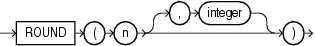

## ROUND (number)

Syntax

round\_number::=



> ```
> ROUND(n [, integer ])
> ```
>
> [  
> Copyright © 1996, 2025, Oracle and/or its affiliates.](https://docs.oracle.com/en/database/oracle/oracle-database/dcommon/html/cpyr.htm)


Purpose

`ROUND` returns `n` rounded to `integer` places to the right of the decimal point. If you omit `integer`, then `n` is rounded to zero places. If `integer` is negative, then `n` is rounded off to the left of the decimal point.

`n` can be any numeric data type or any nonnumeric data type that can be implicitly converted to a numeric data type. If you omit `integer`, then the function returns the value `ROUND` (n, 0) in the same data type as the numeric data type of `n`. If you include `integer`, then the function returns `NUMBER`.

`ROUND` is implemented using the following rules:

1. If `n` is 0, then `ROUND` always returns 0 regardless of `integer`.
2. If `n` is negative, then `ROUND` (n, integer) returns - `ROUND` (-n, integer).
3. If `n` is positive, then
	```
	ROUND(n, integer) = FLOOR(n * POWER(10, integer) + 0.5) * POWER(10, -integer)
	```

`ROUND` applied to a `NUMBER` value may give a slightly different result from `ROUND` applied to the same value expressed in floating-point. The different results arise from differences in internal representations of `NUMBER` and floating point values. The difference will be 1 in the rounded digit if a difference occurs.

See Also:

- [Table 2-8](Data-Type-Comparison-Rules.md) for more information on implicit conversion
- " [Floating-Point Numbers](Data-Types.md) " for more information on how Oracle Database handles `BINARY_FLOAT` and `BINARY_DOUBLE` values
- [FLOOR](FLOOR.md) and [CEIL](CEIL.md), [TRUNC (number)](TRUNC-number.md) and [MOD](MOD.md) for information on functions that perform related operations

Examples

The following example rounds a number to one decimal point:

```
SELECT ROUND(15.193,1) "Round" FROM DUAL;

     Round
----------
      15.2
```

The following example rounds a number one digit to the left of the decimal point:

```
SELECT ROUND(15.193,-1) "Round" FROM DUAL;

     Round
----------
        20
```