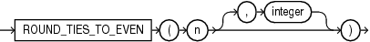

## ROUND\_TIES\_TO\_EVEN (number)

Syntax

round\_ties\_to\_even::=



> ```
> ROUND_TIES_TO_EVEN ( n [, integer ] )
> ```
>
> [  
> Copyright © 1996, 2025, Oracle and/or its affiliates.](https://docs.oracle.com/en/database/oracle/oracle-database/dcommon/html/cpyr.htm)


Purpose

`ROUND_TIES_TO_EVEN` is a rounding function that takes two parameters: `n` and `integer`. The function returns `n` rounded to `integer` places according to the following rules:

1. If `integer` is positive, `n` is rounded to `integer` places to the right of the decimal point.
2. If `integer` is not specified, then `n` is rounded to 0 places.
3. If `integer` is negative, then `n` is rounded to `integer` places to the left of the decimal point.

Restrictions

The function does not support the following types: `BINARY_FLOAT` and `BINARY_DOUBLE`.

Examples

The following example rounds a number to one decimal point to the right:

```
SELECT ROUND_TIES_TO_EVEN (0.05, 1) from DUAL

ROUND_TIES_TO_EVEN(0.05,1)
--------------------------
                        0
```

The following example rounds a number to one decimal point to the left:

```
SELECT ROUND_TIES_TO_EVEN(45.177,-1) "ROUND_EVEN" FROM DUAL;

ROUND_TIES_TO_EVEN(45.177,-1)
-----------------------------
                                50
```