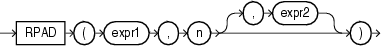

## RPAD

Syntax



> ```
> RPAD(expr1 , n [, expr2 ])
> ```
>
> [  
> Copyright © 1996, 2025, Oracle and/or its affiliates.](https://docs.oracle.com/en/database/oracle/oracle-database/dcommon/html/cpyr.htm)


Purpose

`RPAD` returns `expr1`, right-padded to length `n` characters with `expr2`, replicated as many times as necessary. This function is useful for formatting the output of a query.

Both `expr1` and `expr2` can be any of the data types `CHAR`, `VARCHAR2`, `NCHAR`, `NVARCHAR2`, `CLOB`, or `NCLOB`. The string returned is of `VARCHAR2` data type if `expr1` is a character data type, `NVARCHAR2` if `expr1` is a national character data type, and a LOB if `expr1` is a LOB data type. The string returned is in the same character set as `expr1`. The argument `n` must be a `NUMBER` integer or a value that can be implicitly converted to a `NUMBER` integer.

`expr1` cannot be null. If you do not specify `expr2`, then it defaults to a single blank. If `expr1` is longer than `n`, then this function returns the portion of `expr1` that fits in `n`.

The argument `n` is the total length of the return value as it is displayed on your terminal screen. In most character sets, this is also the number of characters in the return value. However, in some multibyte character sets, the display length of a character string can differ from the number of characters in the string.

See Also:

Appendix C in [Oracle Database Globalization Support Guide](https://docs.oracle.com/pls/topic/lookup?ctx=en/database/oracle/oracle-database/21/sqlrf&id=NLSPG-GUID-AFCE41ED-775B-4A00-AF38-C436776AE0C5) for the collation derivation rules, which define the collation assigned to the character return value of `RPAD`

Examples

The following example creates a simple chart of salary amounts by padding a single space with asterisks:

```
SELECT last_name, RPAD(' ', salary/1000/1, '*') "Salary"
   FROM employees
   WHERE department_id = 80
   ORDER BY last_name, "Salary";

LAST_NAME                 Salary
------------------------- ---------------
Abel                       **********
Ande                       *****
Banda                      *****
Bates                      ******
Bernstein                  ********
Bloom                      *********
Cambrault                  **********
Cambrault                  ******
Doran                      ******
Errazuriz                  ***********
Fox                        ********
Greene                     ********
Hall                       ********
Hutton                     *******
Johnson                    *****
King                       *********
. . .
```