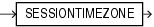

## SESSIONTIMEZONE

Syntax



> ```
> SESSIONTIMEZONE
> ```
>
> [  
> Copyright © 1996, 2025, Oracle and/or its affiliates.](https://docs.oracle.com/en/database/oracle/oracle-database/dcommon/html/cpyr.htm)


Purpose

`SESSIONTIMEZONE` returns the time zone of the current session. The return type is a time zone offset (a character type in the format `'[+|-]TZH:TZM'`) or a time zone region name, depending on how the user specified the session time zone value in the most recent `ALTER` `SESSION` statement.

Note:

The default client session time zone is an offset even if the client operating system uses a named time zone. If you want the default session time zone to use a named time zone, then set the `ORA_SDTZ` variable in the client environment to an Oracle time zone region name. Refer to [Oracle Database Globalization Support Guide](https://docs.oracle.com/pls/topic/lookup?ctx=en/database/oracle/oracle-database/21/sqlrf&id=NLSPG003) for more information on this variable.

See Also:

Appendix C in [Oracle Database Globalization Support Guide](https://docs.oracle.com/pls/topic/lookup?ctx=en/database/oracle/oracle-database/21/sqlrf&id=NLSPG-GUID-AFCE41ED-775B-4A00-AF38-C436776AE0C5) for the collation derivation rules, which define the collation assigned to the character return value of `SESSIONTIMEZONE`

Examples

The following example returns the time zone of the current session:

```
SELECT SESSIONTIMEZONE FROM DUAL;

SESSION
-------
-08:00
```