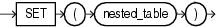

## SET

Syntax



> ```
> SET (nested_table)
> ```
>
> [  
> Copyright © 1996, 2025, Oracle and/or its affiliates.](https://docs.oracle.com/en/database/oracle/oracle-database/dcommon/html/cpyr.htm)


Purpose

`SET` converts a nested table into a set by eliminating duplicates. The function returns a nested table whose elements are distinct from one another. The returned nested table is of the same type as the input nested table.

The element types of the nested table must be comparable. Refer to " [Comparison Conditions](Comparison-Conditions.md) " for information on the comparability of nonscalar types.

Examples

The following example selects from the `customers_demo` table the unique elements of the `cust_address_ntab` nested table column:

```
SELECT customer_id, SET(cust_address_ntab) address
  FROM customers_demo
  ORDER BY customer_id;
```
```
CUSTOMER_ID ADDRESS(STREET_ADDRESS, POSTAL_CODE, CITY, STATE_PROVINCE, COUNTRY_ID)
----------- ------------------------------------------------------------------------
        101 CUST_ADDRESS_TAB_TYP(CUST_ADDRESS_TYP('514 W Superior St', '46901', 'Kokomo', 'IN', 'US'))
        102 CUST_ADDRESS_TAB_TYP(CUST_ADDRESS_TYP('2515 Bloyd Ave', '46218', 'Indianapolis', 'IN', 'US'))
        103 CUST_ADDRESS_TAB_TYP(CUST_ADDRESS_TYP('8768 N State Rd 37', '47404', 'Bloomington', 'IN', 'US'))
        104 CUST_ADDRESS_TAB_TYP(CUST_ADDRESS_TYP('6445 Bay Harbor Ln', '46254', 'Indianapolis', 'IN', 'US'))
        105 CUST_ADDRESS_TAB_TYP(CUST_ADDRESS_TYP('4019 W 3Rd St', '47404', 'Bloomington', 'IN', 'US'))
. . .
```

The preceding example requires the table `customers_demo` and a nested table column containing data. Refer to " [Multiset Operators](Multiset-Operators.md) " to create this table and nested table column.