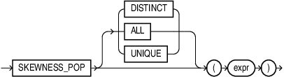

## SKEWNESS\_POP

Syntax



> ```
> SKEWNESS_POP [DISTINCT | ALL | UNIQUE] ( expr )
> ```
>
> [  
> Copyright © 1996, 2025, Oracle and/or its affiliates.](https://docs.oracle.com/en/database/oracle/oracle-database/dcommon/html/cpyr.htm)


Purpose

`SKEWNESS_POP` is an aggregate function that is primarily used to determine symmetry in a given distribution.

NULL values in `expr` are ignored.

Returns NULL if all rows in the group have NULL `expr` values.

Returns 0 if there are one or two rows in `expr`.

For a given set of values, the result of population skewness (`SKEWNESS_POP`) and sample skewness (`SKEWNESS_SAMP`) are always deterministic. However, the values of `SKEWNESS_POP` and `SKEWNESS_SAMP` differ. As the number of values in the data set increases, the difference between the computed values of `SKEWNESS_SAMP` and `SKEWNESS_POP` decreases.