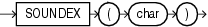

## SOUNDEX

Syntax



> ```
> SOUNDEX(char)
> ```
>
> [  
> Copyright © 1996, 2025, Oracle and/or its affiliates.](https://docs.oracle.com/en/database/oracle/oracle-database/dcommon/html/cpyr.htm)


Purpose

`SOUNDEX` returns a character string containing the phonetic representation of `char`. This function lets you compare words that are spelled differently, but sound alike in English.

The phonetic representation is defined in The Art of Computer Programming, Volume 3: Sorting and Searching, by Donald E. Knuth, as follows:

1. Retain the first letter of the string and remove all other occurrences of the following letters: a, e, h, i, o, u, w, y.
2. Assign numbers to the remaining letters (after the first) as follows:
	```
	b, f, p, v = 1
	c, g, j, k, q, s, x, z = 2
	d, t = 3
	l = 4
	m, n = 5
	r = 6
	```
3. If two or more letters with the same number were adjacent in the original name (before step 1), or adjacent except for any intervening h and w, then retain the first letter and omit rest of all the adjacent letters with same number.
4. Return the first four bytes padded with 0.

`char` can be of any of the data types `CHAR`, `VARCHAR2`, `NCHAR`, or `NVARCHAR2`. The return value is the same data type as `char`.

This function does not support `CLOB` data directly. However, `CLOB` s can be passed in as arguments through implicit data conversion.

See Also:

- " [Data Type Comparison Rules](Data-Type-Comparison-Rules.md) " for more information.
- Appendix C in [Oracle Database Globalization Support Guide](https://docs.oracle.com/pls/topic/lookup?ctx=en/database/oracle/oracle-database/21/sqlrf&id=NLSPG-GUID-AFCE41ED-775B-4A00-AF38-C436776AE0C5) for the collation derivation rules, which define the collation assigned to the character return value of `SOUNDEX`

Examples

The following example returns the employees whose last names are a phonetic representation of "Smyth":

```
SELECT last_name, first_name
     FROM hr.employees
     WHERE SOUNDEX(last_name)
         = SOUNDEX('SMYTHE')
     ORDER BY last_name, first_name;

LAST_NAME  FIRST_NAME
---------- ----------
Smith      Lindsey
Smith      William
```