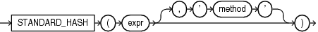

## STANDARD\_HASH

Syntax



> ```
> STANDARD_HASH(expr [, 'method' ])
> ```
>
> [  
> Copyright © 1996, 2025, Oracle and/or its affiliates.](https://docs.oracle.com/en/database/oracle/oracle-database/dcommon/html/cpyr.htm)


Purpose

`STANDARD_HASH` computes a hash value for a given expression using one of several hash algorithms that are defined and standardized by the National Institute of Standards and Technology. This function is useful for performing authentication and maintaining data integrity in security applications such as digital signatures, checksums, and fingerprinting.

You can use the `STANDARD_HASH` function to create an index on an extended data type column. Refer to " [Creating an Index on an Extended Data Type Column](CREATE-INDEX.md) " for more information.

- The `expr` argument determines the data for which you want Oracle Database to compute a hash value. There are no restrictions on the length of data represented by `expr`, which commonly resolves to a column name. The `expr` cannot be a `LONG` or LOB type. It cannot be a user-defined object type. All other data types are supported for `expr`.
- The optional `method` argument lets you specify the name of the hash algorithm to be used. Valid algorithms are `SHA1`, `SHA256`, `SHA384`, `SHA512` and `MD5`. If you omit this argument, then `SHA1` is used.

The function returns a `RAW` value.

Note:

The `STANDARD_HASH` function is not identical to the one used internally by Oracle Database for hash partitioning.