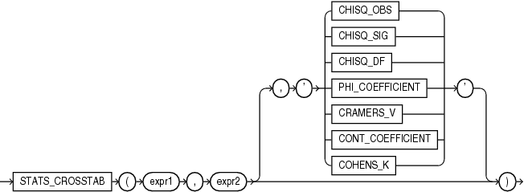

## STATS\_CROSSTAB

Syntax



> ```
> STATS_CROSSTAB(expr1, expr2
>                [, { 'CHISQ_OBS'
>                   | 'CHISQ_SIG'
>                   | 'CHISQ_DF'
>                   | 'PHI_COEFFICIENT'
>                   | 'CRAMERS_V'
>                   | 'CONT_COEFFICIENT'
>                   | 'COHENS_K'
>                   }
>                ]
>               )
> ```
>
> [  
> Copyright © 1996, 2025, Oracle and/or its affiliates.](https://docs.oracle.com/en/database/oracle/oracle-database/dcommon/html/cpyr.htm)


Purpose

Crosstabulation (commonly called crosstab) is a method used to analyze two nominal variables. The `STATS_CROSSTAB` function takes two required arguments: `expr1` and `expr2` are the two variables being analyzed. The optional third argument lets you specify the meaning of the `NUMBER` value returned by this function, as shown in Table 7-4. For this argument, you can specify a text literal, or a bind variable or expression that evaluates to a constant character value. If you omit the third argument, then the default is `'CHISQ_SIG'`.

See Also:

Appendix C in [Oracle Database Globalization Support Guide](https://docs.oracle.com/pls/topic/lookup?ctx=en/database/oracle/oracle-database/21/sqlrf&id=NLSPG-GUID-AFCE41ED-775B-4A00-AF38-C436776AE0C5) for the collation determination rules for `STATS_CROSSTAB`

Table 7-4 STATS\_CROSSTAB Return Values

| Argument | Return Value Meaning |
| --- | --- |
| `'CHISQ_OBS'` | Observed value of chi-squared |
| `'CHISQ_SIG'` | Significance of observed chi-squared |
| `'CHISQ_DF'` | Degree of freedom for chi-squared |
| `'PHI_COEFFICIENT'` | Phi coefficient |
| `'CRAMERS_V'` | Cramer's V statistic |
| `'CONT_COEFFICIENT'` | Contingency coefficient |
| `'COHENS_K'` | Cohen's kappa |

STATS\_CROSSTAB Example

The following example determines the strength of the association between gender and income level:

```
SELECT STATS_CROSSTAB
         (cust_gender, cust_income_level, 'CHISQ_OBS') chi_squared,
       STATS_CROSSTAB
         (cust_gender, cust_income_level, 'CHISQ_SIG') p_value,
       STATS_CROSSTAB
         (cust_gender, cust_income_level, 'PHI_COEFFICIENT') phi_coefficient
  FROM sh.customers;

CHI_SQUARED    P_VALUE PHI_COEFFICIENT
----------- ---------- ---------------
 251.690705 1.2364E-47      .067367056
```