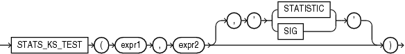

## STATS\_KS\_TEST

Syntax



> ```
> STATS_KS_TEST(expr1, expr2
>               [, { 'STATISTIC' | 'SIG' } ]
>              )
> ```
>
> [  
> Copyright © 1996, 2025, Oracle and/or its affiliates.](https://docs.oracle.com/en/database/oracle/oracle-database/dcommon/html/cpyr.htm)


Purpose

`STATS_KS_TEST` is a Kolmogorov-Smirnov function that compares two samples to test whether they are from the same population or from populations that have the same distribution. It does not assume that the population from which the samples were taken is normally distributed.

This function takes two required arguments: `expr1` classifies the data into the two samples and `expr2` contains the values for each of the samples. If `expr1` classifies the data into only one sample or into more than two samples, then an error is raised. The optional third argument lets you specify the meaning of the `NUMBER` value returned by this function, as shown in Table 7-6. For this argument, you can specify a text literal, or a bind variable or expression that evaluates to a constant character value. If you omit the third argument, then the default is `'SIG'`.

See Also:

Appendix C in [Oracle Database Globalization Support Guide](https://docs.oracle.com/pls/topic/lookup?ctx=en/database/oracle/oracle-database/21/sqlrf&id=NLSPG-GUID-AFCE41ED-775B-4A00-AF38-C436776AE0C5) for the collation determination rules for `STATS_KS_TEST`

Table 7-6 STATS\_KS\_TEST Return Values

| Argument | Return Value Meaning |
| --- | --- |
| `'STATISTIC'` | Observed value of D |
| `'SIG'` | Significance of D |

STATS\_KS\_TEST Example

Using the Kolmogorov Smirnov test, the following example determines whether the distribution of sales between men and women is due to chance:

```
SELECT stats_ks_test(cust_gender, amount_sold, 'STATISTIC') ks_statistic,
       stats_ks_test(cust_gender, amount_sold) p_value
  FROM sh.customers c, sh.sales s
  WHERE c.cust_id = s.cust_id;

KS_STATISTIC    P_VALUE
------------ ----------
  .003841396 .004080006
```