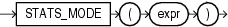

## STATS\_MODE

Syntax



> ```
> STATS_MODE(expr)
> ```
>
> [  
> Copyright © 1996, 2025, Oracle and/or its affiliates.](https://docs.oracle.com/en/database/oracle/oracle-database/dcommon/html/cpyr.htm)


Purpose

`STATS_MODE` takes as its argument a set of values and returns the value that occurs with the greatest frequency. If more than one mode exists, then Oracle Database chooses one and returns only that one value.

To obtain multiple modes (if multiple modes exist), you must use a combination of other functions, as shown in the hypothetical query:

```
SELECT x FROM (SELECT x, COUNT(x) AS cnt1
   FROM t GROUP BY x)
   WHERE cnt1 =
      (SELECT MAX(cnt2) FROM (SELECT COUNT(x) AS cnt2 FROM t GROUP BY x));
```

See Also:

Appendix C in [Oracle Database Globalization Support Guide](https://docs.oracle.com/pls/topic/lookup?ctx=en/database/oracle/oracle-database/21/sqlrf&id=NLSPG-GUID-AFCE41ED-775B-4A00-AF38-C436776AE0C5) for the collation determination rules, which define the collation `STATS_MODE` uses to compare character values for `expr`, and for the collation derivation rules, which define the collation assigned to the return value of this function when it is a character value

Examples

The following example returns the mode of salary per department in the `hr.employees` table:

```
SELECT department_id, STATS_MODE(salary) FROM employees
   GROUP BY department_id
   ORDER BY department_id, stats_mode(salary);

DEPARTMENT_ID STATS_MODE(SALARY)
------------- ------------------
           10               4400
           20               6000
           30               2500
           40               6500
           50               2500
           60               4800
           70              10000
           80               9500
           90              17000
          100               6900
          110               8300
                            7000
```

If you need to retrieve all of the modes (in cases with multiple modes), you can do so using a combination of other functions, as shown in the next example:

```
SELECT commission_pct FROM
   (SELECT commission_pct, COUNT(commission_pct) AS cnt1 FROM employees
      GROUP BY commission_pct)
   WHERE cnt1 = 
      (SELECT MAX (cnt2) FROM
         (SELECT COUNT(commission_pct) AS cnt2
         FROM employees GROUP BY commission_pct))
   ORDER BY commission_pct;

COMMISSION_PCT
--------------
            .2
            .3
```