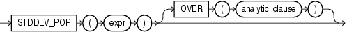

## STDDEV\_POP

Syntax



> ```
> STDDEV_POP(expr)
>    [ OVER (analytic_clause) ]
> ```
>
> [  
> Copyright © 1996, 2025, Oracle and/or its affiliates.](https://docs.oracle.com/en/database/oracle/oracle-database/dcommon/html/cpyr.htm)


See Also:

" [Analytic Functions](Analytic-Functions.md) " for information on syntax, semantics, and restrictions

Purpose

`STDDEV_POP` computes the population standard deviation and returns the square root of the population variance. You can use it as both an aggregate and analytic function.

This function takes as an argument any numeric data type or any nonnumeric data type that can be implicitly converted to a numeric data type. The function returns the same data type as the numeric data type of the argument.

See Also:

[Table 2-8](Data-Type-Comparison-Rules.md) for more information on implicit conversion

This function is the same as the square root of the `VAR_POP` function. When `VAR_POP` returns null, this function returns null.

See Also:

- " [Aggregate Functions](Aggregate-Functions.md) " and [VAR\_POP](VAR_POP.md)
- " [About SQL Expressions](About-SQL-Expressions.md) " for information on valid forms of `expr`

Aggregate Example

The following example returns the population and sample standard deviations of the amount of sales in the sample table `sh.sales`:

```
SELECT STDDEV_POP(amount_sold) "Pop", 
   STDDEV_SAMP(amount_sold) "Samp"
   FROM sales;

       Pop       Samp
---------- ----------
896.355151 896.355592
```

Analytic Example

The following example returns the population standard deviations of salaries in the sample `hr.employees` table by department:

```
SELECT department_id, last_name, salary, 
   STDDEV_POP(salary) OVER (PARTITION BY department_id) AS pop_std
   FROM employees
   ORDER BY department_id, last_name, salary, pop_std;

DEPARTMENT_ID LAST_NAME                     SALARY    POP_STD
------------- ------------------------- ---------- ----------
           10 Whalen                          4400          0
           20 Fay                             6000       3500
           20 Hartstein                      13000       3500
           30 Baida                           2900  3069.6091
. . .
         100 Urman                           7800 1644.18166
          110 Gietz                           8300       1850
          110 Higgins                        12000       1850
              Grant                           7000          0
```