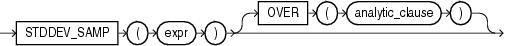

## STDDEV\_SAMP

Syntax



> ```
> STDDEV_SAMP(expr)
>    [ OVER (analytic_clause) ]
> ```
>
> [  
> Copyright © 1996, 2025, Oracle and/or its affiliates.](https://docs.oracle.com/en/database/oracle/oracle-database/dcommon/html/cpyr.htm)


See Also:

" [Analytic Functions](Analytic-Functions.md) " for information on syntax, semantics, and restrictions

Purpose

`STDDEV_SAMP` computes the cumulative sample standard deviation and returns the square root of the sample variance. You can use it as both an aggregate and analytic function.

This function takes as an argument any numeric data type or any nonnumeric data type that can be implicitly converted to a numeric data type. The function returns the same data type as the numeric data type of the argument.

See Also:

[Table 2-8](Data-Type-Comparison-Rules.md) for more information on implicit conversion

This function is same as the square root of the `VAR_SAMP` function. When `VAR_SAMP` returns null, this function returns null.

See Also:

- " [Aggregate Functions](Aggregate-Functions.md) " and [VAR\_SAMP](VAR_SAMP.md)
- " [About SQL Expressions](About-SQL-Expressions.md) " for information on valid forms of `expr`

Aggregate Example

Refer to the aggregate example for [STDDEV\_POP](STDDEV_POP.md).

Analytic Example

The following example returns the sample standard deviation of salaries in the `employees` table by department:

```
SELECT department_id, last_name, hire_date, salary, 
   STDDEV_SAMP(salary) OVER (PARTITION BY department_id 
      ORDER BY hire_date 
      ROWS BETWEEN UNBOUNDED PRECEDING AND CURRENT ROW) AS cum_sdev 
   FROM employees
   ORDER BY department_id, last_name, hire_date, salary, cum_sdev;

DEPARTMENT_ID LAST_NAME       HIRE_DATE     SALARY   CUM_SDEV
------------- --------------- --------- ---------- ----------
           10 Whalen          17-SEP-03       4400
           20 Fay             17-AUG-05       6000 4949.74747
           20 Hartstein       17-FEB-04      13000
           30 Baida           24-DEC-05       2900 4035.26125
           30 Colmenares      10-AUG-07       2500 3362.58829
           30 Himuro          15-NOV-06       2600  3649.2465
           30 Khoo            18-MAY-03       3100 5586.14357
           30 Raphaely        07-DEC-02      11000
. . .
          100 Greenberg       17-AUG-02      12008  2126.9772
          100 Popp            07-DEC-07       6900 1804.13155
          100 Sciarra         30-SEP-05       7700 1929.76233
          100 Urman           07-MAR-06       7800 1788.92504
          110 Gietz           07-JUN-02       8300 2621.95194
          110 Higgins         07-JUN-02      12008
              Grant           24-MAY-07       7000
```