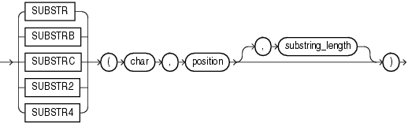

## SUBSTR

Syntax

substr::=



> ```
> { SUBSTR
> | SUBSTRB
> | SUBSTRC
> | SUBSTR2
> | SUBSTR4
> }
> (char, position [, substring_length ])
> ```
>
> [  
> Copyright © 1996, 2025, Oracle and/or its affiliates.](https://docs.oracle.com/en/database/oracle/oracle-database/dcommon/html/cpyr.htm)


Purpose

The `SUBSTR` functions return a portion of `char`, beginning at character `position`, `substring_length` characters long. `SUBSTR` calculates lengths using characters as defined by the input character set. `SUBSTRB` uses bytes instead of characters. `SUBSTRC` uses Unicode complete characters. `SUBSTR2` uses UCS2 code points. `SUBSTR4` uses UCS4 code points.

- If `position` is 0, then it is treated as 1.
- If `position` is positive, then Oracle Database counts from the beginning of `char` to find the first character.
- If `position` is negative, then Oracle counts backward from the end of `char`.
- If `substring_length` is omitted, then Oracle returns all characters to the end of `char`. If `substring_length` is less than 1, then Oracle returns null.

`char` can be any of the data types `CHAR`, `VARCHAR2`, `NCHAR`, `NVARCHAR2`, `CLOB`, or `NCLOB`. The exceptions are `SUBSTRC`, `SUBSTR2`, and `SUBSTR4`, which do not allow `char` to be a `CLOB` or `NCLOB`. Both `position` and `substring_length` must be of data type `NUMBER`, or any data type that can be implicitly converted to `NUMBER`, and must resolve to an integer. The return value is the same data type as `char`, except that for a `CHAR` argument a `VARCHAR2` value is returned, and for an `NCHAR` argument an `NVARCHAR2` value is returned. Floating-point numbers passed as arguments to `SUBSTR` are automatically converted to integers.

See Also:

- For a complete description of character length see [Oracle Database Globalization Support Guide](https://docs.oracle.com/pls/topic/lookup?ctx=en/database/oracle/oracle-database/21/sqlrf&id=NLSPG435) and [Oracle Database SecureFiles and Large Objects Developer's Guide](https://docs.oracle.com/pls/topic/lookup?ctx=en/database/oracle/oracle-database/21/sqlrf&id=ADLOB45586)
- [Oracle Database Globalization Support Guide](https://docs.oracle.com/pls/topic/lookup?ctx=en/database/oracle/oracle-database/21/sqlrf&id=NLSPG007) for more information about `SUBSTR` functions and length semantics in different locales
- Appendix C in [Oracle Database Globalization Support Guide](https://docs.oracle.com/pls/topic/lookup?ctx=en/database/oracle/oracle-database/21/sqlrf&id=NLSPG-GUID-AFCE41ED-775B-4A00-AF38-C436776AE0C5) for the collation derivation rules, which define the collation assigned to the character return value of `SUBSTR`

Examples

The following example returns several specified substrings of "ABCDEFG":

```
SELECT SUBSTR('ABCDEFG',3,4) "Substring"
     FROM DUAL;
 
Substring
---------
CDEF

SELECT SUBSTR('ABCDEFG',-5,4) "Substring"
     FROM DUAL;

Substring
---------
CDEF
```

Assume a double-byte database character set:

```
SELECT SUBSTRB('ABCDEFG',5,4.2) "Substring with bytes"
     FROM DUAL;

Substring with bytes
--------------------
CD
```