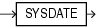

## SYSDATE

Syntax



> ```
> SYSDATE
> ```
>
> [  
> Copyright © 1996, 2025, Oracle and/or its affiliates.](https://docs.oracle.com/en/database/oracle/oracle-database/dcommon/html/cpyr.htm)


Purpose

`SYSDATE` returns the current date and time set for the operating system on which the database server resides. The data type of the returned value is `DATE`, and the format returned depends on the value of the `NLS_DATE_FORMAT` initialization parameter. The function requires no arguments. In distributed SQL statements, this function returns the date and time set for the operating system of your local database. You cannot use this function in the condition of a `CHECK` constraint.

Note:

The `FIXED_DATE` initialization parameter enables you to set a constant date and time that `SYSDATE` will always return instead of the current date and time. This parameter is useful primarily for testing. Refer to [Oracle Database Reference](https://docs.oracle.com/pls/topic/lookup?ctx=en/database/oracle/oracle-database/21/sqlrf&id=REFRN10062) for more information on the `FIXED_DATE` initialization parameter.

Examples

The following example returns the current operating system date and time:

```
SELECT TO_CHAR
    (SYSDATE, 'MM-DD-YYYY HH24:MI:SS') "NOW"
     FROM DUAL;

NOW
-------------------
04-13-2001 09:45:51
```