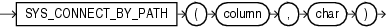

## SYS\_CONNECT\_BY\_PATH

Syntax



> ```
> SYS_CONNECT_BY_PATH(column, char)
> ```
>
> [  
> Copyright © 1996, 2025, Oracle and/or its affiliates.](https://docs.oracle.com/en/database/oracle/oracle-database/dcommon/html/cpyr.htm)


Purpose

`SYS_CONNECT_BY_PATH` is valid only in hierarchical queries. It returns the path of a column value from root to node, with column values separated by `char` for each row returned by `CONNECT` `BY` condition.

Both `column` and `char` can be any of the data types `CHAR`, `VARCHAR2`, `NCHAR`, or `NVARCHAR2`. The string returned is of `VARCHAR2` data type and is in the same character set as `column`.

See Also:

- " [Hierarchical Queries](Hierarchical-Queries.md) " for more information about hierarchical queries and `CONNECT` `BY` conditions
- Appendix C in [Oracle Database Globalization Support Guide](https://docs.oracle.com/pls/topic/lookup?ctx=en/database/oracle/oracle-database/21/sqlrf&id=NLSPG-GUID-AFCE41ED-775B-4A00-AF38-C436776AE0C5) for the collation derivation rules, which define the collation assigned to the character return value of `SYS_CONNECT_BY_PATH`

Examples

The following example returns the path of employee names from employee `Kochhar` to all employees of `Kochhar` (and their employees):

```
SELECT LPAD(' ', 2*level-1)||SYS_CONNECT_BY_PATH(last_name, '/') "Path"
   FROM employees
   START WITH last_name = 'Kochhar'
   CONNECT BY PRIOR employee_id = manager_id;

Path
------------------------------
     /Kochhar/Greenberg/Chen
     /Kochhar/Greenberg/Faviet
     /Kochhar/Greenberg/Popp
     /Kochhar/Greenberg/Sciarra
     /Kochhar/Greenberg/Urman
     /Kochhar/Higgins/Gietz
   /Kochhar/Baer
   /Kochhar/Greenberg
   /Kochhar/Higgins
   /Kochhar/Mavris
   /Kochhar/Whalen
 /Kochhar
```