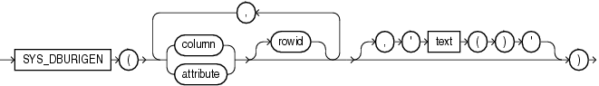

## SYS\_DBURIGEN

Syntax



> ```
> SYS_DBURIGEN({ column | attribute }
>              [ rowid ]
>                [, { column | attribute }
>                   [ rowid ]
>                ]...
>              [, 'text ( )' ]
>             )
> ```
>
> [  
> Copyright © 1996, 2025, Oracle and/or its affiliates.](https://docs.oracle.com/en/database/oracle/oracle-database/dcommon/html/cpyr.htm)


Purpose

`SYS_DBURIGen` takes as its argument one or more columns or attributes, and optionally a rowid, and generates a URL of data type `DBURIType` to a particular column or row object. You can then use the URL to retrieve an XML document from the database.

All columns or attributes referenced must reside in the same table. They must perform the function of a primary key. They need not actually match the primary key of the table, but they must reference a unique value. If you specify multiple columns, then all but the final column identify the row in the database, and the last column specified identifies the column within the row.

By default the URL points to a formatted XML document. If you want the URL to point only to the text of the document, then specify the optional ' `text()` '.

Note:

In this XML context, the lowercase `text` is a keyword, not a syntactic placeholder.

If the table or view containing the columns or attributes does not have a schema specified in the context of the query, then Oracle Database interprets the table or view name as a public synonym.

See Also:

[Oracle XML DB Developer's Guide](https://docs.oracle.com/pls/topic/lookup?ctx=en/database/oracle/oracle-database/21/sqlrf&id=ADXDB4168) for information on the `DBURIType` data type and XML documents in the database

Examples

The following example uses the `SYS_DBURIGen` function to generate a URL of data type `DBURIType` to the `email` column of the row in the sample table `hr.employees` where the `employee_id` = 206:

```
SELECT SYS_DBURIGEN(employee_id, email)
   FROM employees
   WHERE employee_id = 206;

SYS_DBURIGEN(EMPLOYEE_ID,EMAIL)(URL, SPARE)
--------------------------------------------------------------------
DBURITYPE('/PUBLIC/EMPLOYEES/ROW[EMPLOYEE_ID=''206'']/EMAIL', NULL)
```