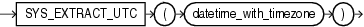

## SYS\_EXTRACT\_UTC

Syntax



> ```
> SYS_EXTRACT_UTC(datetime_with_timezone)
> ```
>
> [  
> Copyright © 1996, 2025, Oracle and/or its affiliates.](https://docs.oracle.com/en/database/oracle/oracle-database/dcommon/html/cpyr.htm)


Purpose

`SYS_EXTRACT_UTC` extracts the UTC (Coordinated Universal Time—formerly Greenwich Mean Time) from a datetime value with time zone offset or time zone region name. If a time zone is not specified, then the datetime is associated with the session time zone.

Examples

The following example extracts the UTC from a specified datetime:

```
SELECT SYS_EXTRACT_UTC(TIMESTAMP '2000-03-28 11:30:00.00 -08:00')
   FROM DUAL;

SYS_EXTRACT_UTC(TIMESTAMP'2000-03-2811:30:00.00-08:00')
-----------------------------------------------------------------
28-MAR-00 07.30.00 PM
```