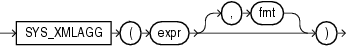

## SYS\_XMLAGG

Syntax



> ```
> SYS_XMLAGG(expr [, fmt ])
> ```
>
> [  
> Copyright © 1996, 2025, Oracle and/or its affiliates.](https://docs.oracle.com/en/database/oracle/oracle-database/dcommon/html/cpyr.htm)


Purpose

`SYS_XMLAgg` aggregates all of the XML documents or fragments represented by `expr` and produces a single XML document. It adds a new enclosing element with a default name `ROWSET`. If you want to format the XML document differently, then specify `fmt`, which is an instance of the `XMLFormat` object.

See Also:

[SYS\_XMLGEN](SYS_XMLGEN.md) and " [XML Format Model](Format-Models.md) " for using the attributes of the `XMLFormat` type to format `SYS_XMLAgg` results

Examples

The following example uses the `SYS_XMLGen` function to generate an XML document for each row of the sample table `employees` where the employee's last name begins with the letter R, and then aggregates all of the rows into a single XML document in the default enclosing element `ROWSET`:

```
SELECT SYS_XMLAGG(SYS_XMLGEN(last_name)) XMLAGG
   FROM employees
   WHERE last_name LIKE 'R%'
   ORDER BY xmlagg;

XMLAGG
--------------------------------------------------------------------------------
<?xml version="1.0"?>
<ROWSET>
<LAST_NAME>Rajs</LAST_NAME>
<LAST_NAME>Raphaely</LAST_NAME>
<LAST_NAME>Rogers</LAST_NAME>
<LAST_NAME>Russell</LAST_NAME>
</ROWSET>
```