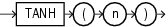

## TANH

Syntax



> ```
> TANH(n)
> ```
>
> [  
> Copyright © 1996, 2025, Oracle and/or its affiliates.](https://docs.oracle.com/en/database/oracle/oracle-database/dcommon/html/cpyr.htm)


Purpose

`TANH` returns the hyperbolic tangent of `n`.

This function takes as an argument any numeric data type or any nonnumeric data type that can be implicitly converted to a numeric data type. If the argument is `BINARY_FLOAT`, then the function returns `BINARY_DOUBLE`. Otherwise the function returns the same numeric data type as the argument.

Examples

The following example returns the hyperbolic tangent of.5:

```
SELECT TANH(.5) "Hyperbolic tangent of .5" 
   FROM DUAL;

Hyperbolic tangent of .5
------------------------
              .462117157
```