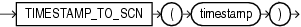

## TIMESTAMP\_TO\_SCN

Syntax



> ```
> TIMESTAMP_TO_SCN(timestamp)
> ```
>
> [  
> Copyright © 1996, 2025, Oracle and/or its affiliates.](https://docs.oracle.com/en/database/oracle/oracle-database/dcommon/html/cpyr.htm)


Purpose

`TIMESTAMP_TO_SCN` takes as an argument a timestamp value and returns the approximate system change number (SCN) associated with that timestamp. The returned value is of data type `NUMBER`. This function is useful any time you want to know the SCN associated with a particular timestamp.

Note:

The association between an SCN and a timestamp when the SCN is generated is remembered by the database for a limited period of time. This period is the maximum of the auto-tuned undo retention period, if the database runs in the Automatic Undo Management mode, and the retention times of all flashback archives in the database, but no less than 120 hours. The time for the association to become obsolete elapses only when the database is open. An error is returned if the timestamp specified for the argument to `TIMESTAMP_TO_SCN` is too old.

See Also:

[SCN\_TO\_TIMESTAMP](SCN_TO_TIMESTAMP.md) for information on converting SCNs to timestamp

Examples

The following example inserts a row into the `oe.orders` table and then uses `TIMESTAMP_TO_SCN` to determine the system change number of the insert operation. (The actual SCN returned will differ on each system.)

```
INSERT INTO orders (order_id, order_date, customer_id, order_total)
   VALUES (5000, SYSTIMESTAMP, 188, 2345);
1 row created.

COMMIT;
Commit complete.

SELECT TIMESTAMP_TO_SCN(order_date) FROM orders
   WHERE order_id = 5000;

TIMESTAMP_TO_SCN(ORDER_DATE)
----------------------------
                      574100
```