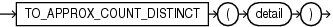

## TO\_APPROX\_COUNT\_DISTINCT

Syntax



> ```
> TO_APPROX_COUNT_DISTINCT(detail)
> ```
>
> [  
> Copyright © 1996, 2025, Oracle and/or its affiliates.](https://docs.oracle.com/en/database/oracle/oracle-database/dcommon/html/cpyr.htm)


Purpose

`TO_APPROX_COUNT_DISTINCT` takes as its input a detail containing information about an approximate distinct value count, and converts it to a `NUMBER` value.

For `detail`, specify a detail of type `BLOB`, which was created by the `APPROX_COUNT_DISTINCT_DETAIL` function or the `APPROX_COUNT_DISTINCT_AGG` function.

See Also:

- [APPROX\_COUNT\_DISTINCT\_DETAIL](APPROX_COUNT_DISTINCT_DETAIL.md)
- TO\_APPROX\_COUNT\_DISTINCT

Examples

Refer to [TO\_APPROX\_COUNT\_DISTINCT: Examples](APPROX_COUNT_DISTINCT_DETAIL.md) for examples of using the `TO_APPROX_COUNT_DISTINCT` function in conjunction with the `APPROX_COUNT_DISTINCT_DETAIL` and `APPROX_COUNT_DISTINCT_AGG` functions.