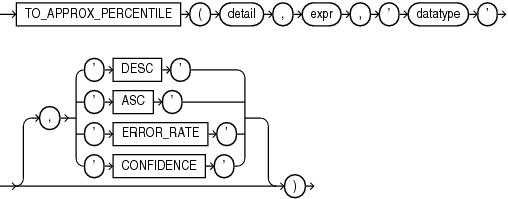

## TO\_APPROX\_PERCENTILE

Syntax



> ```
> TO_APPROX_PERCENTILE(detail, expr, 'datatype'
>   [, { 'DESC' | 'ASC' | 'ERROR_RATE' | 'CONFIDENCE' } ])
> ```
>
> [  
> Copyright © 1996, 2025, Oracle and/or its affiliates.](https://docs.oracle.com/en/database/oracle/oracle-database/dcommon/html/cpyr.htm)


Purpose

`TO_APPROX_PERCENTILE` takes as its input a detail containing approximate percentile information, a percentile value, and a sort specification, and returns an approximate interpolated value that would fall into that percentile value with respect to the sort specification.

For `detail`, specify a detail of type `BLOB`, which was created by the `APPROX_PERCENTILE_DETAIL` function or the `APPROX_PERCENTLE_AGG` function.

For `expr`, specify a percentile value, which must evaluate to a numeric value between 0 and 1. If you specify the `ERROR_RATE` or `CONFIDENCE` clause, then the percentile value does not apply. In this case, for `expr` you must specify null or a numeric value between 0 and 1. However, the value will be ignored.

For `datatype`, specify the data type of the approximate percentile information in the detail. This is the data type of the expression supplied to the `APPROX_PERCENTILE_DETAIL` function that originated the detail. Valid data types are `NUMBER`, `BINARY_FLOAT`, `BINARY_DOUBLE`, `DATE`, `TIMESTAMP`, `INTERVAL` `YEAR` `TO` `MONTH`, and `INTERVAL` `DAY` `TO` `SECOND`.

DESC | ASC

Specify the sort specification for the interpolation. Specify `DESC` for a descending sort order, or `ASC` for an ascending sort order. `ASC` is the default.

ERROR\_RATE | CONFIDENCE

These clauses let you determine the accuracy of the percentile evaluation of the detail. If you specify one of these clauses, then instead of returning the approximate interpolated value, the function returns a decimal value from 0 to 1, inclusive, which represents one of the following values:

- If you specify `ERROR_RATE`, then the return value represents the error rate of the percentile evaluation for the detail.
- If you specify `CONFIDENCE`, then the return value represents the confidence level for the error rate returned when you specify `ERROR_RATE`.

If you specify `ERROR_RATE` or `CONFIDENCE`, then the percentile value `expr` is ignored.

See Also:

- [APPROX\_PERCENTILE\_DETAIL](APPROX_PERCENTILE_DETAIL.md)
- [APPROX\_PERCENTILE\_AGG](APPROX_PERCENTILE_AGG.md)

Examples

Refer to [APPROX\_PERCENTILE\_AGG: Examples](APPROX_PERCENTILE_DETAIL.md) for examples of using the `TO_APPROX_PERCENTILE` function in conjunction with the `APPROX_PERCENTILE_DETAIL` and `APPROX_PERCENTILE_AGG` functions.