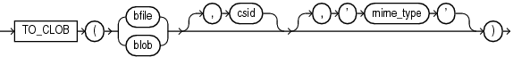

## TO\_CLOB (bfile|blob)

Syntax



> ```
> TO_CLOB( { bfile | blob } [, csid] [, mime_type] )
> ```
>
> [  
> Copyright © 1996, 2025, Oracle and/or its affiliates.](https://docs.oracle.com/en/database/oracle/oracle-database/dcommon/html/cpyr.htm)


Purpose

`TO_CLOB` (bfile|blob) converts `BFILE` or `BLOB` data to the database character set and returns the data as a `CLOB` value.

For `csid`, specify the character set ID of the `BFILE` or `BLOB` data. If the character set of the `BFILE` or `BLOB` data is the database character set, then you can specify a value of 0 for `csid`, or omit `csid` altogether.

For `mime_type`, specify the MIME type to be set on the `CLOB` value returned by this function. If you omit `mime_type`, then a MIME type will not be set on the `CLOB` value.

See Also:

Appendix C in [Oracle Database Globalization Support Guide](https://docs.oracle.com/pls/topic/lookup?ctx=en/database/oracle/oracle-database/21/sqlrf&id=NLSPG-GUID-AFCE41ED-775B-4A00-AF38-C436776AE0C5) for the collation derivation rules, which define the collation assigned to the character return value of this function

Example

The following hypothetical example returns the `CLOB` of a `BFILE` column value `docu` in table `media_tab`, which uses the character set with ID 873. It sets the MIME type to `text/xml` for the resulting `CLOB`.

```
SELECT TO_CLOB(docu, 873, 'text/xml') FROM media_tab;
```