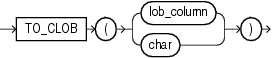

## TO\_CLOB (character)

Syntax



> ```
> TO_CLOB(lob_column | char)
> ```
>
> [  
> Copyright © 1996, 2025, Oracle and/or its affiliates.](https://docs.oracle.com/en/database/oracle/oracle-database/dcommon/html/cpyr.htm)


Purpose

`TO_CLOB` (character) converts `NCLOB` values in a LOB column or other character strings to `CLOB` values. `char` can be any of the data types `CHAR`, `VARCHAR2`, `NCHAR`, `NVARCHAR2`, `CLOB`, or `NCLOB`. Oracle Database executes this function by converting the underlying LOB data from the national character set to the database character set.

From within a PL/SQL package, you can use the `TO_CLOB` (character) function to convert `RAW`, `CHAR`, `VARCHAR`, `VARCHAR2`, `NCHAR`, `NVARCHAR2`, `CLOB`, or `NCLOB` values to `CLOB` or `NCLOB` values.

See Also:

Appendix C in [Oracle Database Globalization Support Guide](https://docs.oracle.com/pls/topic/lookup?ctx=en/database/oracle/oracle-database/21/sqlrf&id=NLSPG-GUID-AFCE41ED-775B-4A00-AF38-C436776AE0C5) for the collation derivation rules, which define the collation assigned to the character return value of this function

Examples

The following statement converts `NCLOB` data from the sample `pm.print_media` table to `CLOB` and inserts it into a `CLOB` column, replacing existing data in that column.

```
UPDATE PRINT_MEDIA 
   SET AD_FINALTEXT = TO_CLOB (AD_FLTEXTN);
```