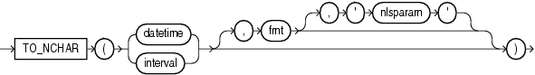

## TO\_NCHAR (datetime)

Syntax

to\_nchar\_date::=



> ```
> TO_NCHAR({ datetime | interval }
>          [, fmt [, 'nlsparam' ] ]
>         )
> ```
>
> [  
> Copyright © 1996, 2025, Oracle and/or its affiliates.](https://docs.oracle.com/en/database/oracle/oracle-database/dcommon/html/cpyr.htm)


Purpose

`TO_NCHAR` (datetime) converts a datetime or interval value of `DATE`, `TIMESTAMP`, `TIMESTAMP` `WITH` `TIME` `ZONE`, `TIMESTAMP` `WITH` `LOCAL` `TIME` `ZONE`, `INTERVAL` `MONTH` `TO` `YEAR`, or `INTERVAL` `DAY` `TO` `SECOND` data type from the database character set to the national character set.

See Also:

- " [Security Considerations for Data Conversion](Data-Type-Comparison-Rules.md) "
- Appendix C in [Oracle Database Globalization Support Guide](https://docs.oracle.com/pls/topic/lookup?ctx=en/database/oracle/oracle-database/21/sqlrf&id=NLSPG-GUID-AFCE41ED-775B-4A00-AF38-C436776AE0C5) for the collation derivation rules, which define the collation assigned to the character return value of this function

Examples

The following example converts the `order_date` of all orders whose status is `9` to the national character set:

```
SELECT TO_NCHAR(ORDER_DATE) AS order_date
   FROM ORDERS
   WHERE ORDER_STATUS > 9
   ORDER BY order_date;

ORDER_DATE
--------------------------------------------------------------------------
06-DEC-99 02.22.34.225609 PM
13-SEP-99 10.19.00.654279 AM
14-SEP-99 09.53.40.223345 AM
26-JUN-00 10.19.43.190089 PM
27-JUN-00 09.53.32.335522 PM
```